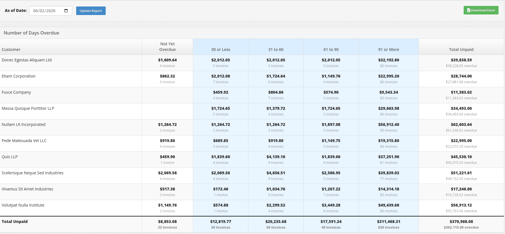
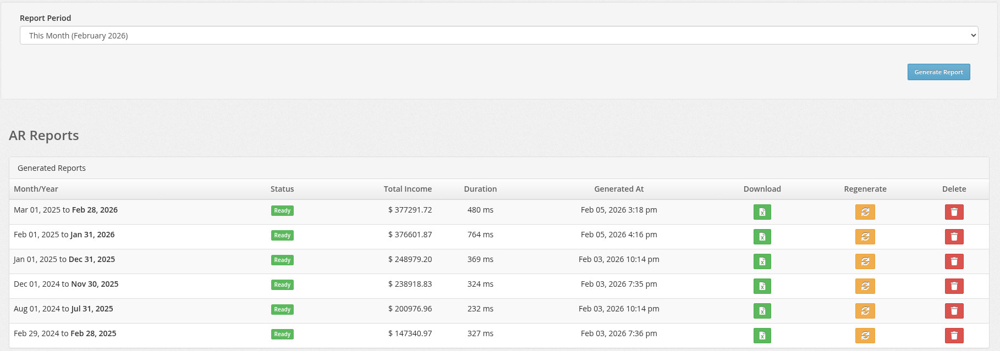

# Aged Receivables

See who owes you money and how old the debt is, either as a strict as-of-date snapshot or as a saved 12-month performance file.

## :fontawesome-solid-file-invoice-dollar: Overview

UTX Freight has **two** aged receivables reports. Both live under **Reports** in the left menu, and they answer different questions:

| Menu entry | Report | Page subtitle | What it is |
|------------|--------|---------------|------------|
| **Aged Receivables (AR)** | **Standard Aged Receivables** | *Standard Aged Receivables* | A snapshot of every unpaid balance as of a date you pick, aged by **due date**. Shown on screen, calculated live, with an Excel download |
| **AR Export** | **Performance report** | *Aged Receivables (AR)* | A saved Excel file per month covering the **12 months** ending at that month's end: income, invoice and order counts, and unpaid balances aged by **invoice date** |

!!! warning "The names cross over"
    The menu entry **Aged Receivables (AR)** opens the **Standard Aged Receivables** page. The menu entry **AR Export** opens the Performance report page, whose subtitle reads **Aged Receivables (AR)**. Go by the menu entry, not the page subtitle.

- :fontawesome-solid-calendar-day: **Standard**: pick an **As of Date:**, click **Update Report**, read the table, click **Download Excel**. Nothing is saved.
- :fontawesome-solid-file-excel: **Performance**: pick a **Report Period** (a month), click **Generate Report**. The file is saved in the **Generated Reports** list where you can download, regenerate or delete it.
- :fontawesome-solid-scale-balanced: Need the invoices behind a number? Use the **AR Aging** filter and the **AR aging detail** export on the [Invoices](invoices.md) page. See [Reconciling with the Invoices page](#reconciling-with-the-invoices-page).

---

## :fontawesome-solid-bolt: Quick Start

**Standard Aged Receivables (accounting snapshot):**

1. Go to **Reports** > **Aged Receivables (AR)**.
2. Set **As of Date:** (it defaults to today) and click **Update Report**.
3. Click :fontawesome-solid-file-excel: **Download Excel** to get the same figures as a spreadsheet.

**Performance report (12-month file):**

1. Go to **Reports** > **AR Export**.
2. Choose a **Report Period**, for example **Last Month**, and click **Generate Report**.
3. In **Generated Reports**, check that **Status** is **Ready**, then click the green :fontawesome-solid-file-excel: button in the **Download** column.

---

## :fontawesome-solid-shield-halved: Access & Permissions

Both reports use the same permission as the rest of the **Reports** menu.

| Role | Access |
|------|--------|
| :fontawesome-solid-user-shield: **Admin** | Full access to both reports |
| :fontawesome-solid-user-tie: **Manager** | Only if viewing reports is enabled for managers on your UTX Freight installation. Otherwise the **Reports** menu is not shown. Contact UTX support to change this |
| :fontawesome-solid-file-invoice-dollar: **Accountant** | No access. The **Reports** menu is not shown |
| :fontawesome-solid-headset: **Dispatch** | No access |
| :fontawesome-solid-user: **Customer**, **Warehouse**, **Garage**, drivers | No access |

!!! info "Accountants and the Invoices page"
    Accountants cannot open either report, but they can use the **AR Aging** filter and the **AR aging detail** export on the [Invoices](invoices.md) page, which give the same aging bands per invoice. See [User Roles](user-roles.md).

**How to get there:**

- :fontawesome-solid-arrow-right: **Reports** > **Aged Receivables (AR)** for the Standard report
- :fontawesome-solid-arrow-right: **Reports** > **AR Export** for the Performance report

!!! info "Office scope"
    Both reports work on the **office you are currently in**. With [Multi-Office](multi-office.md) on, switch office to report on another office. The Performance report's **Generated Reports** list is also kept per office. See [Office scope in detail](#office-scope-in-detail) for how each report picks invoices.

---

## :fontawesome-solid-calendar-day: Standard Aged Receivables

Menu: **Reports** > **Aged Receivables (AR)**. Page subtitle: **Standard Aged Receivables**.

This is the accounting view: what was owed on a given date, and how far past due each balance was on that date. The blue box at the top (**Standard Aged Receivables Information**) describes it as a GAAP-compliant snapshot. You can close the box with its **×**.

### Running the report

1. Go to **Reports** > **Aged Receivables (AR)**. The report opens already calculated **as of today**.
2. To look at another date, pick it in **As of Date:** (a single date picker, not a month and year).
3. Click **Update Report**.
4. Click :fontawesome-solid-file-excel: **Download Excel** to download the figures for the date the report on screen was calculated for. If you changed **As of Date:**, click **Update Report** first, otherwise the file uses the previous date.

!!! info "Calculated live, nothing is saved"
    The Standard report is recalculated every time you open the page, click **Update Report** or click **Download Excel**. There is no list of saved Standard reports. Running it for a past date again later can give different figures if invoices or payments dated on or before that date were added or changed in the meantime.

### The table

The table sits under the heading **Number of Days Overdue**. There is one row per customer that had an unpaid balance on the as-of date, sorted by customer name.

| Column | What it holds |
|--------|---------------|
| **Customer** | Customer (company) name |
| **Not Yet Overdue** | Unpaid balances whose due date is **after** the as-of date |
| **30 or Less** | 0 to 30 days past the due date |
| **31 to 60** | 31 to 60 days past due |
| **61 to 90** | 61 to 90 days past due |
| **91 or More** | More than 90 days past due |
| **Total Unpaid** | Sum of all the columns, with the overdue part shown underneath as *$… overdue* |

Under each amount, a small grey line shows how many invoices make it up (for example *2 invoices*). Empty cells mean nothing in that bucket.

The last row, **Total Unpaid**, adds up every customer: an amount and invoice count per bucket, plus the grand total and the total *overdue*.

If no customer had an unpaid balance on the date, the page shows **No data found for the selected date.**

### How the Standard report calculates

| Rule | Detail |
|------|--------|
| **Aged by due date** | Days overdue = as-of date minus the invoice's **due date**. An old invoice with no due date on record is aged from its invoice date |
| **Day 0 is overdue** | An invoice due **on** the as-of date is 0 days overdue. It goes in **30 or Less** and counts toward *overdue*. Only invoices due after the as-of date are **Not Yet Overdue** |
| **Business dates, not entry dates** | Only invoices whose **invoice date** is on or before the as-of date are included. Only payment lines whose **payment date** is on or before the as-of date reduce the balance. When you entered them in the system does not matter |
| **Balance** | Invoice total including taxes, minus the payment lines dated on or before the as-of date |
| **Invoices marked Paid** | An invoice with status **Paid** is counted only if its paid date, or the date of one of its payment lines, is after the as-of date. Otherwise it is treated as fully settled on that date, even if its payment lines do not add up to the invoice total |
| **Starting point** | Invoices dated before the **Order Start Date** in [Application Settings](application-settings.md) are left out. If no start date is set, all earlier invoices count |
| **Deleted customers** | Invoices of deleted customers are left out |
| **Zero and credit balances** | Invoices with no positive balance are skipped. A customer whose total unpaid is less than $0.01 does not get a row |
| **Office** | With Multi-Office on, only invoices issued by the current office are counted |

!!! tip "Example"
    An invoice dated March 1 with Net 30 terms is due March 31. As of March 30 it is **Not Yet Overdue**. As of March 31 it is in **30 or Less** (0 days). As of May 1 it is 31 days past due and moves to **31 to 60**.

### The Excel file

**Download Excel** gives you:

- File name: `Standard_Aged_Receivables_YYYY-MM-DD.xlsx` (the as-of date)
- One sheet named `Standard AR YYYY-MM`
- Columns: **Customer**, **Not Yet Overdue**, **30 or Less**, **31 to 60**, **61 to 90**, **91 or More**, **Total Unpaid**
- One row per customer, then a **TOTALS** row

!!! warning "The Excel has amounts only"
    The spreadsheet does not include the invoice counts under each amount or the *overdue* line under **Total Unpaid**. If you need the overdue total in Excel, add up the four overdue columns (**30 or Less** to **91 or More**).

---

## :fontawesome-solid-chart-line: Performance Report (AR Export)

Menu: **Reports** > **AR Export**. Page subtitle: **Aged Receivables (AR)**.

This is the business view. For a chosen month it looks at the **12 months** ending on that month's last day: how much you invoiced, to whom, and how much of it is still unpaid. The blue box at the top (**Report Processing Information**) describes it as a report designed for Business Performance. You can close the box with its **×**.

### Generating a report

1. Go to **Reports** > **AR Export**.
2. In **Report Period**, pick one of the **Quick Selections**:
    - **This Month (*Month Year*)**
    - **Last Month (*Month Year*)**
    - **2 Months Ago (*Month Year*)**
    - **3 Months Ago (*Month Year*)**
3. Or pick **Custom Month/Year** (under **Custom Selection**). Two drop-downs appear: **Month** and **Year**. **Year** goes from five years back to next year.
4. Click **Generate Report**. The button reads **Generating...** while the report is built.
5. A notification **Report Generated Successfully** appears and the report shows up in **Generated Reports**.

!!! warning "One report per month"
    Each office can have only **one** Performance report per month and year. If one already exists, **Generate Report** is refused with the notification **Report Already Exists**: *A report for this month/year already exists. Please use the Regenerate button instead.* Use :fontawesome-solid-arrows-rotate: **Regenerate** on the existing row, or delete it first.

!!! info "Check the Status column"
    The success notification appears once processing finishes, even if processing failed. Always check the **Status** of the row. If it says **Failed**, see [Failed reports](#failed-reports).

### The reporting window

The report's **as-of date** is the **last day** of the month you selected. The window is the 12 months ending on that day, **excluding** the start day. The **Month/Year** column shows it exactly, for example selecting October 2026 shows *Nov 01, 2025 to **Oct 31, 2026***.

- Only invoices whose **invoice date** falls inside the window are included, paid or not.
- Payments count only if their payment date is on or before the as-of date.
- **Unpaid invoices older than 12 months are not in this report at all.** Use the Standard report for the complete unpaid ledger.
- If you pick **This Month**, the as-of date is the end of the current month. Invoices and payments added later in the month are only picked up when you **Regenerate**.

### What the Excel file contains

- File name starts with `ar-report-` and includes the report year and month.
- One sheet named `AR Report YYYY-MM`.
- One row for **every** customer (company) of the office that is not deleted, including customers with nothing in the window (their figures are 0).
- A **TOTALS** row at the bottom.

| Column | What it holds |
|--------|---------------|
| **Customer** | Customer (company) name |
| **Invoices** | Number of the customer's invoices dated inside the window |
| **Completed Orders** | Number of orders on those invoices |
| **All Income** | Total of those invoices, including taxes, whether paid or not |
| **AR As Of YYYY-MM-DD** | Unpaid balance on the as-of date, for invoices inside the window. Equal to the four bucket columns added together |
| **30 days** | Unpaid on invoices 0 to 30 days old (from the invoice date) |
| **60 days** | Unpaid on invoices 31 to 60 days old |
| **90 days** | Unpaid on invoices 61 to 90 days old |
| **90+ days** | Unpaid on invoices more than 90 days old (up to the 12-month limit) |

!!! info "Aged by invoice date, not due date"
    The Performance buckets measure the **age of the invoice** (as-of date minus **invoice date**), not days past due. A Net 30 invoice dated 40 days before the as-of date is in **60 days** here, but only 10 days overdue (**30 or Less**) in the Standard report.

Like the Standard report, the Performance report uses invoice totals including taxes, subtracts only payment lines dated on or before the as-of date, and leaves out invoices of deleted customers. An invoice marked **Paid** that has no payment lines counts as settled only if its paid date is **before** the as-of date. Unlike the Standard report, it does **not** use the **Order Start Date** setting, and it does not skip **Paid** invoices up front: a **Paid** invoice whose payment lines are dated on or before the as-of date but add up to less than the total still shows the difference as unpaid.

### Generated Reports

Below the form, the **AR Reports** section lists your saved reports for the current office in a **Generated Reports** table, newest month first.

| Column | What it shows |
|--------|---------------|
| **Month/Year** | The 12-month window, start date to **end date** (end date in bold) |
| **Status** | **Ready**, **Generating** or **Failed** (see below) |
| **Total Income** | Total of all invoices in the window, including taxes (same as **All Income** on the **TOTALS** row). Shows **-** when it is zero |
| **Duration** | How long the last generation took, in ms (and in seconds when over one second) |
| **Generated At** | When the file was last built successfully (by **Generate Report** or **Regenerate**) |
| **Download** | Green :fontawesome-solid-file-excel: button, only when **Ready** |
| **Regenerate** | Orange :fontawesome-solid-arrows-rotate: button, only when **Ready** |
| **Delete** | Red :fontawesome-solid-trash: button, when **Ready** or **Failed** |

If you have no reports yet, the section shows **No reports generated yet. Use the form above to request a report.**

### Statuses

| Status | Colour | Meaning | What you can do |
|--------|--------|---------|-----------------|
| **Ready** | Green | The file is built and stored | Download, Regenerate, Delete |
| **Generating** | Yellow | The report is being built. **Download** and **Regenerate** show a spinner | Wait. Nothing else is available |
| **Failed** | Red | Building the file failed. The start of the error message is shown under the label | Delete, then generate again |

### Downloading

Click the green :fontawesome-solid-file-excel: button in the **Download** column. The file opens in a new browser tab, which downloads it. The button exists only when the status is **Ready**.

### Regenerating

Use **Regenerate** after fixing invoices or payments in the period, or to refresh a **This Month** report.

1. Click the orange :fontawesome-solid-arrows-rotate: button in the **Regenerate** column (only shown when **Ready**).
2. Confirm **Regenerate this report?** (*This will delete the existing file and generate a new one based on current data.*) with **Regenerate**.
3. The old file is replaced by a new one built from current data, and **Generated At** and **Duration** update.

!!! warning "The previous file is gone"
    Regenerating deletes the existing file for that month. Download it first if you need to keep the old figures.

### Deleting

1. Click the red :fontawesome-solid-trash: button in the **Delete** column.
2. Confirm **DELETE this report** (*Are you sure you want to delete this report?*) with **DELETE THIS REPORT**.
3. The row and its stored file are removed and **Report Deleted Successfully** appears. You can now generate a new report for that month and year.

!!! danger "Deleting cannot be undone"
    The stored file is deleted with the row. You can rebuild the month with **Generate Report**, but it will reflect current data, not what the deleted file showed.

### Failed reports

A **Failed** report has no **Download** or **Regenerate** button. To try again:

1. Click :fontawesome-solid-trash: **Delete** on the failed row and confirm.
2. Select the same month in **Report Period** and click **Generate Report**.

If it fails again, contact UTX support with the month and year and the error shown under **Failed**.

### Reports stuck in Generating

Reports are normally built straight away when you click **Generate Report** or **Regenerate**. If that is interrupted, the row can stay in **Generating**. A scheduled background task picks up every report still in **Generating** and builds it, so the row moves to **Ready** (or **Failed**) on its own. Reload the page later to see the new status.

---

## :fontawesome-solid-code-compare: Which Report Should I Use?

| | Standard Aged Receivables | Performance report |
|---|---|---|
| **Menu entry** | **Aged Receivables (AR)** | **AR Export** |
| **Primary goal** | Accounting, month-end and year-end close, audits | Business health: recent sales and collections |
| **Date you choose** | Any day (**As of Date:**) | A month (as-of date = last day of the month) |
| **Invoices included** | Every invoice with a balance on the as-of date, back to the **Order Start Date** | Invoices dated in the 12 months ending at the month end |
| **Aged by** | **Due date** (days past due) | **Invoice date** (age of the invoice) |
| **Buckets** | **Not Yet Overdue**, **30 or Less**, **31 to 60**, **61 to 90**, **91 or More** | **30 days**, **60 days**, **90 days**, **90+ days** |
| **Shows income?** | No, unpaid only | Yes, **All Income**, **Invoices**, **Completed Orders** |
| **Customers listed** | Only those with a balance | Every non-deleted customer of the office |
| **Saved?** | No, calculated live | Yes, one Excel file per month in **Generated Reports** |
| **Output** | Screen table and Excel | Excel only |
| **Multi-Office** | Customers of the current office, invoices issued by the current office | Customers of the current office, any issuing office |

---

## :fontawesome-solid-scale-balanced: Reconciling with the Invoices page

The [Invoices](invoices.md) page has an [AR Aging (Days Past Due)](invoices.md#ar-aging-days-past-due) filter whose exact bands (**Not Due**, **0-30**, **31-60**, **61-90**, **91+**) use the **same boundaries** as the Standard report's columns (**Not Yet Overdue**, **30 or Less**, **31 to 60**, **61 to 90**, **91 or More**). To see the invoices behind a figure:

1. Run the Standard report **as of today** (the Invoices page always ages as of today), then note the customer and the bucket.
2. Go to **Invoices**, click the matching aging band, and search for the customer name. Or export with the [AR aging detail layout](invoices.md#ar-aging-detail-layout) and sum its bucket columns per customer.

The totals are **not expected to match exactly**. Common reasons:

| Reason | Standard report | Invoices page and AR aging detail export |
|--------|-----------------|------------------------------------------|
| **Date** | As of the date you picked | Always as of **today** |
| **Starting point** | Leaves out invoices dated before the **Order Start Date** | Lists every invoice, including older ones |
| **Payments** | Counts only payment lines dated on or before the as-of date | Counts all payment lines, whatever their date |
| **Paid status** | A **Paid** invoice still shows a balance if its paid date or one of its payment lines is dated after the as-of date | Status **Paid** is settled outright, with no balance and no aging |
| **Deleted customers** | Left out | Included |
| **Filters** | None besides office | Whatever status tab, search, date range and aging option you have active |

The Performance report will differ even more, because it ages by invoice date and drops unpaid invoices older than 12 months.

!!! tip "Tying out to the penny"
    Run the Standard report **as of today**, then export the Invoices page with **All Unpaid**, no date range, no aging option and the **AR aging detail** layout. Remaining differences usually come from invoices dated before the **Order Start Date**, invoices of deleted customers, or payment dates typed in the future (a **Paid** invoice with a future paid date or payment line still has a balance on the report; an unpaid invoice with a future-dated payment line shows a larger balance on the report than on the Invoices page).

---

## :fontawesome-solid-building: Office scope in detail

- **Standard report**: includes customers of the office you are in. With Multi-Office on, it also keeps only invoices **issued by** that office.
- **Performance report**: includes customers of the office you are in and all of their invoices, without checking which office issued each invoice. Saved reports, the one-per-month rule, and **Delete**/**Regenerate** all apply per office.

See [Multi-Office](multi-office.md).

---

## :fontawesome-solid-circle-question: FAQ / Troubleshooting

### :fontawesome-solid-eye-slash: I don't see the Reports menu or these reports

!!! info "Solution"
    Only **Admins** have the **Reports** menu by default. **Managers** have it only if viewing reports is enabled for managers on your installation. **Accountants** never do. Ask an Admin to run the report, or use the **AR Aging** filter and export on the [Invoices](invoices.md) page.

### :fontawesome-solid-ban: Generate Report says "Report Already Exists"

!!! info "Solution"
    A Performance report for that month and year already exists in this office. Click :fontawesome-solid-arrows-rotate: **Regenerate** on its row to rebuild it with current data. If its status is **Failed**, delete it first, then click **Generate Report** again.

### :fontawesome-solid-triangle-exclamation: My report says Failed and has no Regenerate button

!!! info "Solution"
    **Regenerate** is only offered for **Ready** reports. Delete the failed row with :fontawesome-solid-trash: and generate the month again. If it keeps failing, contact UTX support.

### :fontawesome-solid-spinner: My report has been Generating for a long time

!!! info "Solution"
    A scheduled background task finishes reports left in **Generating**. Reload the page later. You cannot delete or regenerate a report while it is **Generating**.

### :fontawesome-solid-calculator: The Standard report and the Performance report show different unpaid totals

!!! info "Solution"
    That is expected. The Standard report covers every unpaid invoice back to the **Order Start Date** and ages by due date. The Performance report covers only invoices dated in the last 12 months and ages by invoice date. Use the Standard report for accounting figures.

### :fontawesome-solid-clock-rotate-left: A past as-of date gives different figures than last time

!!! info "Solution"
    The Standard report is recalculated every time. If someone added a payment line dated on or before that date, changed an invoice date, edited an invoice amount or deleted a customer since you last ran it, the figures change. Keep the downloaded Excel file if you need a fixed record for a closed period.

### :fontawesome-solid-file-invoice: An invoice is due today but shows as overdue

!!! info "Solution"
    In the Standard report, an invoice due on the as-of date is 0 days overdue. It sits in **30 or Less** and counts toward the *overdue* amount. Only invoices due after the as-of date are **Not Yet Overdue**.

### :fontawesome-solid-magnifying-glass: An old unpaid invoice is missing from the Standard report

!!! info "Solution"
    Check the invoice date against the **Order Start Date** in [Application Settings](application-settings.md). Invoices dated before it are left out. Also check that the customer is not deleted, and, with Multi-Office on, that the invoice was issued by the office you are in.

### :fontawesome-solid-file-excel: The Standard Excel file has no invoice counts or overdue total

!!! info "Solution"
    The download contains amounts only. The invoice counts and the *overdue* line appear on screen only. Add up **30 or Less** to **91 or More** to get the overdue total.

---

## :fontawesome-solid-lightbulb: Best Practices

!!! tip "Best Practices"
    - Use the **Standard** report for month-end and year-end close. Run it as of the last day of the period and keep the downloaded Excel file as your record.
    - Record payments with their real payment dates. Both reports use payment dates, so a mistyped date moves a balance into the wrong period.
    - Set the **Order Start Date** to the day you started invoicing in UTX Freight, so balances that belong to your old system do not appear.
    - **Regenerate** the current month's Performance report after month-end so it includes the whole month.
    - Download a Performance file before regenerating or deleting it if you need the old figures.

<!-- TODO: Screenshot — AR Export page showing the Report Period selector with Quick Selections open, and the Generated Reports table with Ready, Generating and Failed rows -->
<!-- TODO: Screenshot — Standard Aged Receivables page showing the As of Date: picker, Update Report and Download Excel buttons, and the Total Unpaid row with invoice counts and the overdue line -->
