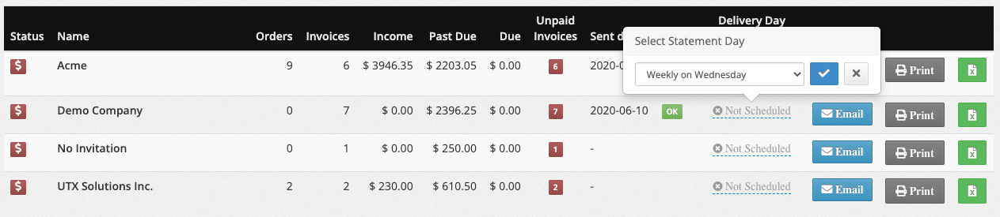
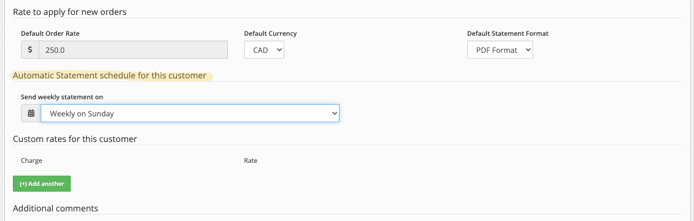

# Automatic Statements

Schedule a recurring day for each customer so UTX Freight emails them their statement of account automatically, without anyone clicking **Email**.

## :fontawesome-solid-circle-info: Overview

- Each customer can have one **statement schedule**: a day of the week, the 1st of the month, the 15th of the month, or twice a month on the 2nd and 16th.
- A background job sends the statement on the scheduled date to the customer's **Accountant Email**, with the same attachment (PDF or Excel) you would get from a manual send. See [Customer Statements](customer-statements.md) for what the statement contains.
- Only **active** customers are emailed. In the automatic run, a customer with no unpaid balance does not get an email.
- The **Customer Reports** page shows, for every customer, the schedule, the **Next Date**, the **Sent date** and the result of the last delivery.
- Automatic statements are a Freight feature. Garage customers have their own, separate statement schedule (see [Garage Reports](garage-reports.md)).

!!! info "Feature availability"
    Automatic statements must be turned on for your account by UTX (account option `automated_statement_enabled`). When it is off, the **Delivery Day / Next Date** column, the day counters on **Customer Reports**, and the **Automatic Statement schedule for this customer** section on the customer form are all hidden. The **Sent date** and **Email** columns and the manual **Email** button are still shown. Contact UTX support if you don't see the scheduling options.

## :fontawesome-solid-bolt: Quick Start

1. Make sure the customer has an **Accountant Email** and is **Active** (**Customers** > **Edit Customer**).
2. Go to **Reports** > **Customer Reports**.
3. Click the value in the **Delivery Day / Next Date** column for the customer (it reads **Not Scheduled** if none is set).
4. Pick a schedule (for example **Weekly on Friday**) and click the check-mark button to save.
5. The blue badge under the schedule shows when the next statement will go out (**Today**, **Tomorrow** or **In N days**).

## :fontawesome-solid-lock: Access & Permissions

| Role | Access |
|------|--------|
| :fontawesome-solid-user-shield: **Admin** | Full access: set schedules from **Customer Reports** or **Edit Customer**, and send statements manually. |
| :fontawesome-solid-user-tie: **Manager** | Can set the schedule from **Customers** > **Edit Customer**. Can use **Reports** > **Customer Reports** (inline schedule, counters, manual **Email**) only if your account allows managers to view reports. |
| :fontawesome-solid-headset: **Dispatch** / **Customer Service** | No access to **Customer Reports**. Can set the schedule from **Edit Customer** only if your account allows dispatchers to manage customers. Customer Service users have the same permissions as Dispatch. |
| :fontawesome-solid-calculator: **Accountant** | No access. Accountants can't open **Customer Reports** or edit customers, so they can't change statement schedules. |
| :fontawesome-solid-user: **Customer / Driver / Warehouse / Garage** | No access. |

See [User Roles](user-roles.md) for how roles and account options work.

## :fontawesome-solid-calendar-days: Schedule Options

The same list of options appears in the customer form and in the **Customer Reports** dropdown (titled **Select Statement Day**).

| Option | When the statement is sent |
|--------|----------------------------|
| **Weekly on Sunday** … **Weekly on Saturday** | Every week on that weekday. |
| **Bi-Weekly on the 2nd and 16th** | Twice a month, on the 2nd and the 16th. Despite the name, this is not every two weeks. |
| **Monthly on the 1st** | Once a month, on the 1st. |
| **Monthly on the 15th** | Once a month, on the 15th. |
| **Not Scheduled** | No automatic statement. This removes the schedule. |

!!! info "Labels"
    On the customer form the field is called **Send weekly statement on**, even though it also holds the monthly and twice-a-month options. In the **Customer Reports** column, the twice-a-month option shows as **Bi-Weekly on 2nd and 16th**.

There is no "send now" or "Today" option. To send a statement right away, use the **Email** button (see [Sending a statement manually](#sending-a-statement-manually)).

## :fontawesome-solid-pen-to-square: Adding a Statement Schedule to a Customer

You can set the schedule in **2 ways**. Both save the same setting.

### Edit the schedule on the Customer Reports screen

1. Navigate to :fontawesome-solid-chart-bar: **Reports** :fontawesome-solid-arrow-right: **Customer Reports**.
2. Find your **Customer** by name. You can pick one customer in the **Customer** filter and click **Update Report**, or leave **[ALL CUSTOMERS]**.
3. Click the value in the **Delivery Day / Next Date** column for this customer.
4. Choose an option from the dropdown.
5. Click the check-mark button to save.
6. Once saved, the **Next Date** badge shows when the statement will be delivered automatically.

### Edit the Customer to set the schedule

1. From the left menu, select :fontawesome-solid-building: **Customers**.
2. Find your **Customer** by name.
3. Click **Edit Customer**.
4. In the **Automatic Statement schedule for this customer** section, choose an option from **Send weekly statement on**.
5. Click **Save Changes**.

### Related customer fields

These fields on the customer form control who gets the statement and what it looks like:

| Field | Effect on automatic statements |
|-------|--------------------------------|
| **Accountant Email** | The **To** address. Required: if it is empty or invalid, the statement is not sent. |
| **Accountant Email (CC)** | Added to **CC**. |
| **Default Statement Format** | **PDF Format** or **Excel (.xlsx)**: the attachment type. |
| **Active** | Only active customers receive automatic statements. Deleted customers are never sent one. |

## :fontawesome-solid-clock: When Statements Are Sent

### The Next Date

The **Next Date** badge (and the job that sends statements) works out the next date like this:

- **Weekly:** the next time that weekday comes around, counting today. If the statement was already sent today, it moves to the same weekday next week.
- **Monthly on the 1st / 15th:** that day in the current month if it hasn't passed yet; otherwise that day next month. If the statement was already sent on that date, it moves to next month.
- **Bi-Weekly on the 2nd and 16th:** whichever of the next 2nd or the next 16th comes first, using the monthly rule above for each.

The badge reads **Today**, **Tomorrow**, or **In** followed by the time left (for example **In 3 days** or **In about 1 month**).

!!! tip "Setting today's day"
    If you pick today's weekday (or today's date for a monthly option), the **Next Date** shows **Today** and the customer is picked up by the next run of the job that day, unless a statement was already sent to them today. If the job does not run again before the end of the day, nothing is sent and the **Next Date** moves to the following scheduled date.

<!-- TODO: Screenshot — Delivery Day / Next Date column showing the blue "Today" / "In N days" badges -->

### How the job runs

- Statements are sent by a background job that runs on a schedule managed by UTX. The time of day it runs isn't set in UTX Freight, so don't count on a specific hour.
- On each run, the job looks at active (not deleted) customers that have a schedule, whose **Next Date** is today, and whose **Sent date** is not today.
- Customers are processed in alphabetical order by name.
- Each run stops after about **20 customers** (20 on multi-office accounts, 21 on single-office accounts), waiting **10 seconds** after each one. On single-office accounts, every due customer counts toward this limit, including customers with a $0 balance and customers skipped because of an invalid email setup, so the limit is on customers processed, not emails sent.
- Customers that a run doesn't reach are handled by a later run, but only while their scheduled date is still today. **There is no catch-up:** once the date passes, the **Next Date** moves to the next scheduled date and nothing is sent for the missed one.

!!! warning "Spread your schedules"
    Because each run processes only about 20 customers, putting many customers on the same day increases the chance that some are skipped for that cycle. Since customers are processed alphabetically, the ones skipped are those later in the alphabet. Spread customers across different weekdays and monthly options, and check the day counters (below) to keep each day light.

!!! tip "Update before the scheduled day"
    The statement reflects invoices and payments at the moment it is sent. Post payments and fix invoices the day before a customer's scheduled date so they receive an accurate statement.

### Who gets an email

- **Single office:** every due customer is processed. If the customer's unpaid balance (the total of their invoices not marked **Paid**, minus payments applied to those invoices) is **greater than $0**, the statement is emailed. If it is $0, no email is sent, but the **Sent date** is still set to today with the message **Statement Not Sent (0.0$)**.
- **Multi-office:** see **Multi-Office Accounts** below.

!!! info "Zero balance applies to the automatic run only"
    The "no email at $0" rule only applies to the automatic job. A manual send with the **Email** button always sends the statement, even when the balance is zero.

## :fontawesome-solid-envelope: Recipients and Email Content

| Part | Value |
|------|-------|
| **From** | Your company name with the **Accountant Email** from your application settings (described there as the default From address for invoices). If your account sends email through Postmark, the visible sender may be a UTX sending address, with **Reply-To** set to that Accountant Email. See [Application Settings](application-settings.md). |
| **To** | The customer's **Accountant Email**. |
| **CC** | The customer's **Accountant Email (CC)** plus the **Invoice Default CC Address** from your application settings. |
| **Subject** | `<Your company name> Statement of Account as of <date>` (the company name UTX set up for your account). On multi-office accounts, ` - <Office name>` is added at the end. |
| **Attachment** | `Statement of account as of <date>.pdf` or `.xlsx`, depending on the customer's **Default Statement Format**. |
| **Body** | A `Statement of Account for <date>` heading and a short message saying the statement of account is attached as a PDF or XLSX. |

Before sending, the automatic run checks the addresses: the **To** address (the customer's **Accountant Email**) must be present and valid, the **CC** addresses must be valid, and the **Invoice 'From' Address Override** in your application settings (or the default UTX set for your account when it is empty) must be a valid address. If any check fails, the customer is skipped (see below).

The attachment is the same one a manual **Email** send produces. See [Customer Statements](customer-statements.md) for what the statement contains and [Application Settings](application-settings.md) for the email settings.

## :fontawesome-solid-list-check: Sent Date and Delivery Status

Two columns on **Customer Reports** show the result of the last statement:

- **Sent date:** the date of the last statement attempt that was recorded, or `-` if none.
- **Email:** a label, green **OK** or red **Failed!**. Hover over the label to see the message.

| What happened | Sent date | Email label | Hover message |
|---------------|-----------|-------------|---------------|
| Automatic run, balance > $0, email sent | Today | **OK** | Statement Delivered |
| Automatic run, balance $0 (single office) | Today | **OK** | Statement Not Sent (0.0$) |
| Automatic run, error while sending | Today | **Failed!** | The error message |
| Automatic run, invalid email setup (missing or invalid **To**, invalid **CC**, or invalid **Invoice 'From' Address Override**) | Not changed | Not changed | Not changed |
| Manual **Email**, sent successfully | Today | **OK** | Statement Delivered |
| Manual **Email**, error while sending | Not changed | **Failed!** | The error message |

!!! warning "A failed automatic send is not retried"
    When the automatic run hits an error, the **Sent date** is still set to today, so the customer is not retried that day. The next attempt is on the next scheduled date. Fix the problem and use **Email** to send the statement manually.

!!! warning "Invalid email setup"
    If the customer has no valid **Accountant Email**, or the **CC** or **Invoice 'From' Address Override** addresses are invalid, the automatic run skips the customer without changing **Sent date** or **Email**. Nothing on the screen tells you it was skipped. Because **Sent date** isn't set, the customer stays due and is tried again by every run that day, taking a place in each run's limit. Check that every scheduled customer has a valid **Accountant Email**.

### Sending a statement manually

1. On **Reports** > **Customer Reports**, click the blue **Email** button on the customer's row.
2. In **Send statement to customer**, check **To** (pre-filled with the customer's **Accountant Email**) and **Cc** (pre-filled with the customer's **Accountant Email (CC)**). Add a **Bcc** if needed.
3. Click **Send**.

A successful manual send sets **Sent date** to today. If today is also the customer's scheduled date, the automatic run skips them, so they don't get two statements the same day.

## :fontawesome-solid-chart-column: Scheduler Information (Day Counters)

At the top right of **Customer Reports**, a row of counters shows how many customers are scheduled for each option: **Sun** to **Sat** (weekend days in red, weekdays in blue), then **1st**, **15th** and **2nd & 16th** (green).

!!! info "What the counters count"
    The counters count **customers with a schedule**, not emails delivered. They include inactive and deleted customers that still have a schedule, so the number can be higher than the number of statements actually sent. Set inactive customers to **Not Scheduled** to keep the counts meaningful.

## :fontawesome-solid-building: Multi-Office Accounts

On accounts with more than one office:

- Statements are **per office**. Each email covers only that office's invoices, and the subject ends with ` - <Office name>`.
- The job goes office by office (offices are not processed in any guaranteed order). A customer is emailed for an office only if they have an unpaid balance **in that office**. Offices where the balance is $0 are skipped, and nothing is recorded for them (no **Sent date**, no **Statement Not Sent (0.0$)** message).
- Once a customer has been sent a statement on their scheduled date, their **Sent date** is today, so the same run doesn't send them another one. This also applies when the send failed (the **Sent date** is set to today in that case too). In practice, a customer with balances in several offices receives the statement for only one office, the first one processed where they owe money, on that date. Send the other offices' statements manually with **Email** while working in each office.
- The 20-customer limit applies to the whole run, across all offices. Only customers with a balance in the office being processed count toward it.
- A manual **Email** send uses the office you are currently working in. See [Multi-Office](multi-office.md).

## :fontawesome-solid-clock-rotate-left: Activity Log

Each automatic attempt (sent, not sent at $0, failed, or invalid email setup) is also written to UTX Freight's internal activity log, with the message (for example `Statement Sent to <customer>`, `Statement Not Sent to <customer> - (0.0$)`, the error message, or `Invalid Email Config`), whether it succeeded, and how long it took. This log isn't shown on a screen in the app; the **Sent date** and **Email** columns on **Customer Reports** are what you see. Contact UTX support if you need the history of attempts for a customer.

## :fontawesome-solid-circle-question: FAQ / Troubleshooting

### :fontawesome-solid-ban: The customer is scheduled but didn't receive a statement

!!! info "Solution"
    Check, in order:

    1. **Is the customer Active?** Inactive customers show **Not Scheduled** in the column (a **Next Date** badge can still appear under it if a schedule is saved) and are never emailed.
    2. **Does the customer have an Accountant Email?** Without a valid one, the statement is skipped silently.
    3. **Was the balance $0?** Hover over the **Email** label. **Statement Not Sent (0.0$)** means there was nothing to collect.
    4. **Is the label Failed!?** Hover to read the error, fix it, and send manually with **Email**.
    5. **Were many customers due that day?** Each run processes about 20 customers, in alphabetical order. If the customer wasn't reached on their date, they wait for the next scheduled date. Send manually if needed and spread out the schedules.

### :fontawesome-solid-calendar-xmark: I changed the schedule to today but nothing was sent yet

!!! info "Solution"
    The statement goes out on the next run of the job, not the moment you save. The job runs on a schedule managed by UTX. If you need it now, click **Email** on **Customer Reports**.

### :fontawesome-solid-calendar-day: Why is "Bi-Weekly" sending twice a month instead of every two weeks?

!!! info "Solution"
    **Bi-Weekly on the 2nd and 16th** sends on two fixed dates each month, the 2nd and the 16th. There is no every-other-week option.

### :fontawesome-solid-eye-slash: I can't see the Delivery Day / Next Date column

!!! info "Solution"
    Either automatic statements aren't enabled for your account (contact UTX support), or your role can't open **Customer Reports**. See **Access & Permissions** above.

### :fontawesome-solid-hashtag: The day counter says 40 but far fewer statements went out

!!! info "Solution"
    The counters count customers with a schedule (including inactive and deleted ones), not deliveries. Customers with a $0 balance aren't emailed either.

### :fontawesome-solid-screwdriver-wrench: Do Garage customers use this schedule?

!!! info "Solution"
    No. Garage customers have their own statement schedule and job. See [Garage Reports](garage-reports.md).

## :fontawesome-solid-star: Best Practices

!!! tip "Best Practices"
    - Fill in **Accountant Email** for every customer before scheduling them.
    - Spread customers across weekdays and monthly options so each day's counter stays low.
    - Post payments the day before a customer's scheduled date.
    - Check the **Email** column after each scheduled day for **Failed!** labels.
    - Set customers you deactivate to **Not Scheduled** so the counters stay accurate.
