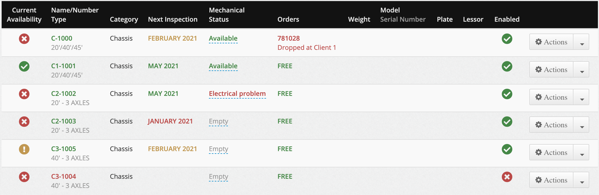
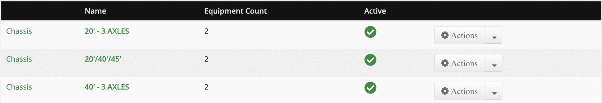
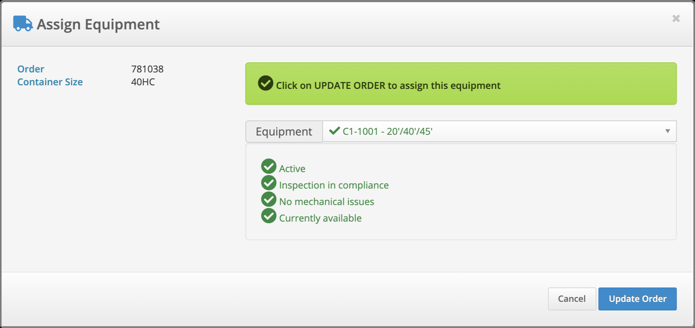

# Equipment (Chassis, Trailers & Trucks)

Keep a list of your chassis, trailers and trucks, track their inspection dates and mechanical condition, and see at a glance which units are free to assign to an order.

## :fontawesome-solid-truck: Overview

- :fontawesome-solid-list: The **Equipments** page (left menu) lists every unit in your current office, 25 per page, with filters, a search box, inline **Mechanical Status** and **Notes**, and a CSV **Export** for admins.
- :fontawesome-solid-sitemap: Every unit has an **Equipment Type** (a name you define, for example *40' - 2 AXLES*). Each type belongs to one of three fixed **Sub Categories**: **Chassis**, **Truck** or **Trailer**. The sub category is shown in the **Category** column.
- :fontawesome-solid-traffic-light: A **Current Availability** icon combines four checks: enabled or disabled, inspection date, mechanical status, and whether the unit is already on an order in progress.
- :fontawesome-solid-link: You assign a **Chassis** or **Trailer** to an order with the **Assign Equipment** modal from the **Orders** list or the **Dispatch** board. Trucks cannot be assigned to orders.
- :fontawesome-solid-triangle-exclamation: Availability warnings in the **Assign Equipment** modal are **advisory only**. They never stop you from assigning a unit.
- :fontawesome-solid-ban: There is no delete for equipment. Disable a unit you no longer use.
- :fontawesome-solid-screwdriver-wrench: This page is about freight (dispatch) equipment. Equipment in the **Garage** add-on is a separate list (see [Garage equipment is separate](#garage-equipment-is-separate)).

---

## :fontawesome-solid-bolt: Quick Start

1. Make sure the equipment types you need exist: click your name at the top right :fontawesome-solid-arrow-right: **Manage Equipment Types**.
2. Go to :fontawesome-solid-arrow-right: **Equipments** in the left menu and click **Add a new Equipment**.
3. Enter the **Name/Number**, pick the **Type**, set the **Next Inspection Date**, and click **Save**.
4. To assign it, click the :fontawesome-solid-truck: button in the **Chassis #** (intermodal) or **Equipment #** column of an order on **Orders** or **Dispatch**, pick the unit in the **Assign Equipment** modal and click **Update Order**.
5. When a unit has a problem, click its **Mechanical Status** on the list and pick the new status (for example **Flat tire**). It turns red and shows as unavailable.

---

## :fontawesome-solid-shield-halved: Access & Permissions

| Role | Equipments page (add, edit, status, notes, disable/enable) | Manage Equipment Types | Export | Assign Equipment / Available Equipments |
|------|------|------|------|------|
| :fontawesome-solid-user-tie: **Admin** | Yes | Yes | Yes | Yes |
| :fontawesome-solid-user-tie: **Manager** | Yes | Yes | No | Yes |
| :fontawesome-solid-headset: **Dispatch** | Yes | Yes | No | Yes |
| :fontawesome-solid-headset: **Customer Service** | Yes (same as Dispatch) | Yes | No | Yes |
| :fontawesome-solid-file-invoice-dollar: **Accountant** | No — the menu item is hidden | No | No | **Assign Equipment** only if your account has order management for accountants turned on — ask UTX support. **Available Equipments**: No |
| :fontawesome-solid-user: **Customer**, **Driver**, other roles | No | No | No | No |

**Where to find it:**

- :fontawesome-solid-arrow-right: Left menu :fontawesome-solid-truck: **Equipments** — the equipment list
- :fontawesome-solid-arrow-right: Your name (top right) :fontawesome-solid-arrow-right: **Manage Equipment Types** — the equipment types
- :fontawesome-solid-arrow-right: **Orders** :fontawesome-solid-arrow-right: **Equipment** button (in the **ACTION & ORDERS** box), or **Dispatch** :fontawesome-solid-arrow-right: **Chassis** header button — the **Available Equipments** modal
- :fontawesome-solid-arrow-right: The :fontawesome-solid-truck: button on each order row of **Orders** or **Dispatch** — the **Assign Equipment** modal

!!! info "Current office"
    The list shows the equipment of the office you are currently working in. With [multiple offices](multi-office.md), switch office to see another office's equipment. See [User Roles](user-roles.md) for what each role can do elsewhere.

---

## :fontawesome-solid-sitemap: Sub Categories and Equipment Types

UTX Freight uses two levels to classify equipment:

| Level | What it is | Where you see it |
|-------|-----------|------------------|
| **Sub Category** | One of three fixed values: **Chassis**, **Truck**, **Trailer**. You cannot add more. | **Category** column on the Equipments list; the **Chassis**, **Trucks** and **Trailers** filters |
| **Equipment Type** | A name you create under a sub category, for example *40' - 2 AXLES* | Grey text under the unit name on the list; the **Type** field shows it as *Sub Category: Name* (for example *Chassis: 40' - 2 AXLES*) |

The sub category decides what you can do with the unit:

- **Chassis** and **Trailer** units can be assigned to orders.
- **Truck** units appear on the Equipments list but never appear in the **Assign Equipment** or **Available Equipments** lists.

### :fontawesome-solid-list-ul: The Equipment Types page

Open it from your name at the top right :fontawesome-solid-arrow-right: **Manage Equipment Types**.

The page lists each type with these columns:

| Column | Shows |
|--------|-------|
| *(first column)* | The sub category (Chassis, Truck or Trailer) |
| **Name** | The type name. Green when the type is active, red when it is not |
| **Equipment Count** | How many units use this type |
| **Active** | Whether the type is active |
| *(actions)* | **Edit**, **View History**, and **Delete** |

!!! warning "Delete only appears for unused types"
    **Delete** only appears when no equipment **and** no order uses the type. You are asked **Are you sure?** before it is removed. If a type is in use, make it inactive instead.

### :fontawesome-solid-pen: Adding or editing a type

1. Click **Add a new Equipment Type** (or **Edit** in a row's actions).
2. Fill in the **Equipment Type Information** form:

| Field | Notes |
|-------|-------|
| **Name** | Required. For example *40' - 3 AXLES* |
| **Office** | The office this type applies to. Hint: *Office for which this equipment type applies* |
| **Sub Category** | **Chassis**, **Truck** or **Trailer**. A new type is **Chassis** unless you choose otherwise |
| **Active** | Hint: *Only active equipment types will be visible for new orders*. Inactive types are not offered when you add equipment. A unit that already uses an inactive type keeps it, and the type stays selectable when you edit that unit |

3. Click **Save**.

### :fontawesome-solid-seedling: Types created with a new installation

A new UTX Freight installation starts with these types, all under the **Chassis** sub category:

*20' - 3 AXLES*, *20'/40'*, *20'/40'/45'*, *20' BI-TRAIN - 2 AXLES*, *20' BI-TRAIN - 3 AXLES*, *20' BI-TRAIN - 3 AXLES (Fixed 5th wheel)*, *40' - 2 AXLES*, *40' - 2 AXLES COMBO*, *40' - 3 AXLES*, *40' - 3 AXLES COMBO*, *40'/45'*, *40'/45'/53'*, *40'/53'*, *TRUCK*

!!! tip "The starter TRUCK type"
    The starter type named *TRUCK* is set up under the **Chassis** sub category. Units of that type show **Chassis** in the **Category** column, appear under the **Chassis** filter and can be assigned to orders. If you track trucks, edit the type and set its **Sub Category** to **Truck** (or create a new type under **Truck**). Your installation may have renamed or changed these types.

---

## :fontawesome-solid-list: The Equipments List

Go to :fontawesome-solid-arrow-right: **Equipments**. The list shows 25 units per page, enabled units first, then by name.

### :fontawesome-solid-filter: Filters

The filter buttons are on the left. **Active** is selected when you open the page.

| Filter | Shows |
|--------|-------|
| **All** | Every unit, enabled and disabled |
| **Active** | Enabled units only (default) |
| **Chassis** | Units whose type is in the **Chassis** sub category (enabled and disabled) |
| **Trucks** | Units whose type is in the **Truck** sub category (enabled and disabled) |
| **Trailers** | Units whose type is in the **Trailer** sub category (enabled and disabled) |
| **Disabled** | Disabled units only |
| **Inspection Due** | Units whose **Next Inspection Date** is in the current calendar month (enabled and disabled) |
| **Inspection Past Due** | Units whose **Next Inspection Date** is before the first day of the current month (enabled and disabled) |

### :fontawesome-solid-magnifying-glass: Search

Type in the **Filter equipment** box. The list updates as you type (once you have entered at least 2 characters, or when you clear the box) and stays within the selected filter. The search matches any part of the:

- Name/Number
- Equipment type name
- Sub category (for example *trailer*)
- Mechanical status
- Plate number
- Serial number

### :fontawesome-solid-table-columns: Columns

| Column | Shows |
|--------|-------|
| **Current Availability** | Overall availability icon (see [Availability rules](#availability-rules)) |
| **Name/Number** / **Type** | The unit name in bold — green if enabled, red if disabled — followed by the equipment type name in grey |
| **Category** | The sub category: Chassis, Truck or Trailer |
| **Next Inspection** | Month and year of the next inspection (for example *MARCH 2027*), coloured by inspection status. Empty if no date is set |
| **Mechanical Status** | The current mechanical status, green or red. Click it to change it (see below) |
| **Orders** | **FREE** in green when the unit is not on any order in progress. Otherwise, in red, the reference of each order in progress with its container status and customer name |
| **Notes** | The unit's notes in bold red, or **Add note** in grey when empty. Click to edit (see below) |
| **Weight** | Tare weight and unit (Lbs or Kgs) |
| **Model** / **Serial Number** | Model, with the serial number in grey underneath |
| **Plate** | Plate number |
| **Lessor** | Lessor or mortgagee |
| **Enabled** | Whether the unit is enabled |
| *(actions)* | **Actions** menu: **Edit**, **View History**, and **Disable** or **Enable** |

### :fontawesome-solid-palette: Colour Guide

| Colour / icon | Meaning |
|---------------|---------|
| :fontawesome-solid-circle-check: Green | Available / in compliance / no mechanical issue / **FREE** |
| :fontawesome-solid-circle-exclamation: Orange | Inspection is due this month, everything else is fine |
| :fontawesome-solid-circle-xmark: Red | Not available: disabled, inspection past due, a mechanical issue, or already on an order in progress |
| Red name | The unit is disabled |
| Red notes | The unit has notes — read them before using it |

### :fontawesome-solid-wrench: Changing the Mechanical Status inline

1. Click the status in the **Mechanical Status** column.
2. Pick a status from the **Enter new equipment status** list (or the empty choice to clear it).
3. Confirm. The row refreshes with the new colour and availability.

### :fontawesome-solid-note-sticky: Editing Notes inline

1. Click the note (or **Add note**) in the **Notes** column.
2. Type in the **Equipment notes** box (for example repair needs or garage status).
3. Confirm. Notes also appear in red in the **Assign Equipment** modal when someone picks this unit.

---

## :fontawesome-solid-plus: Adding and Editing Equipment

1. Click **Add a new Equipment** at the top right of the **Equipments** page, or **Actions** :fontawesome-solid-arrow-right: **Edit** on a row.
2. The **Equipment Information** (or **Edit Equipment Information**) window opens.
3. Fill in the fields and click **Save**. **Cancel** returns to the list.

| Field | Notes |
|-------|-------|
| **Name/Number** | Required. Must be unique — two units cannot have the same name, even in different offices. Use **Borrowed** for the special borrowed-chassis unit (see [Borrowed equipment](#borrowed-equipment)) |
| **Office** | The office the unit belongs to. Only your offices are listed |
| **Type** | Required. Shown as *Sub Category: Type name*. Only active types are offered for a new unit |
| **Next Inspection Date** | Date picker. Hint: *Date of the next inspection*. Drives the inspection status |
| **Serial Number** | Free text |
| **Model** | Free text |
| **Year** | Free text |
| **Plate number** | Free text |
| **Equipment Status** | The mechanical status (see [Mechanical statuses](#mechanical-statuses)). Can be left empty |
| **Lessor or Morgagee** | Free text |
| **Tare weight** and **Units** | The weight and **Lbs** or **Kgs** |
| **Notes** | Hint: *Notes about this equipment (repair needs, garage status, etc.). Visible on the equipment list and when assigning it to an order.* |
| **Active** | Hint: *Only active equipments will be visible for new orders*. Unchecked = disabled |

### :fontawesome-solid-toggle-off: Disabling and enabling

Use **Actions** :fontawesome-solid-arrow-right: **Disable** (or **Enable**) on a row. A message confirms *Equipment <name> - Disabled* (or *- Enabled*). You can also untick **Active** in the edit form.

- A disabled unit no longer appears in the **Assign Equipment** list or the **Available Equipments** modal.
- Disabling does **not** remove the unit from orders it is already on. Those orders keep it, and the **Orders** column still lists them.
- Anyone who can manage equipment can enable a disabled unit again. It does not have to be the person who disabled it.

!!! info "No delete"
    The **Actions** menu has no **Delete** for equipment. Disable units you no longer use. Their history and their links to past orders are kept.

### :fontawesome-solid-clock-rotate-left: View History

**Actions** :fontawesome-solid-arrow-right: **View History** shows who changed the unit, when, and what changed (including inline status and note changes).

---

## :fontawesome-solid-scale-balanced: Availability Rules

The **Current Availability** icon and the **Assign Equipment** checks combine four statuses. If any one of them is red, the unit is red.

### Active status

| State | Result |
|-------|--------|
| Enabled | :fontawesome-solid-circle-check: **Active** |
| Disabled | :fontawesome-solid-circle-xmark: **Disabled** |

### Inspection status

Inspection is compared by **calendar month**, not by exact day.

| Next Inspection Date | Inspection status | Colour |
|----------------------|-------------------|--------|
| A later month than the current one | **In Compliance** — *Inspection in compliance* | Green |
| Any day in the current month | **Due** — *DUE for inspection* | Orange |
| An earlier month | **Past Due** — *Inspection is PAST DUE* | Red |
| No date set | **In Compliance** | Green |

!!! info "Example"
    On October 10, a unit with a next inspection date of October 31 is **Due**, and one with September 30 is **Past Due**. A unit with November 1 is **In Compliance**.

### Mechanical statuses

There are 10 statuses. Eight of them make the unit unavailable.

| Mechanical status | Unit available? |
|-------------------|-----------------|
| **Available** | :fontawesome-solid-circle-check: Yes |
| **Frame yard** | :fontawesome-solid-circle-check: Yes |
| *(empty)* | :fontawesome-solid-circle-check: Yes |
| **At inspection** | :fontawesome-solid-circle-xmark: No |
| **Being repaired** | :fontawesome-solid-circle-xmark: No |
| **Electrical problem** | :fontawesome-solid-circle-xmark: No |
| **Expired** | :fontawesome-solid-circle-xmark: No |
| **Flat tire** | :fontawesome-solid-circle-xmark: No |
| **In garage** | :fontawesome-solid-circle-xmark: No |
| **Other problem** | :fontawesome-solid-circle-xmark: No |
| **Parked at SAAQ** | :fontawesome-solid-circle-xmark: No |

In the **Assign Equipment** modal an unavailable status shows as *Mechanical issue - FLAT TIRE* (the status in capitals). Otherwise it shows *No mechanical issues*.

### Assignment status

A unit is **in use** while it is on an order whose status is **New**, **App. Made** (**Appointment Made**) or **Dispatched**. Once the order moves to any other status, such as **Completed**, the unit is **FREE** again. See [Order Status Workflow](order-workflow.md).

A unit should be on only one order in progress at a time. If it is already on another order in progress, it shows red.

| Shown in Assign Equipment | Meaning |
|---------------------------|---------|
| *Currently available* | Not on any order in progress |
| *Currently assigned to this order* | Only on the order you are editing |
| *Already assigned to another order* | On at least one other order in progress |

---

## :fontawesome-solid-link: Assign Equipment

Assign a chassis or trailer to an order from the **Orders** list or the **Dispatch** board.

1. Click the :fontawesome-solid-truck: button in the **Chassis #** (intermodal) or **Equipment #** column of the order row. The button shows the current equipment name.
2. The **Assign Equipment** modal opens. It shows the **Order** number and, for intermodal installations, the **Container Size**.
3. Pick a unit in the **Equipment** list. Each option shows *Name - Type name* with an icon:
    - :fontawesome-solid-check: green — available
    - :fontawesome-solid-circle-exclamation: orange — usable, with a warning (inspection due this month)
    - :fontawesome-solid-ban: red — not available (inspection past due, mechanical issue, or already on another order in progress)
4. Read the message and the status report below the list (see the tables below).
5. Click **Update Order**. To remove the equipment from the order, pick **-- No Equipment --** and click **Update Order**. **Cancel** closes without changes.

The list only contains **enabled Chassis and Trailer** units of your current office. Available units are listed first, then units with a warning, then unavailable ones; within each group, by type name and then by the number at the start of the unit name (names that do not start with a number come first).

!!! warning "Warnings never block"
    The red and orange messages are there to help you choose. UTX Freight still saves the assignment when you click **Update Order**, even for a unit that is past due, has a mechanical issue or is on another order.

### Message at the top

| Message | Colour | When |
|---------|--------|------|
| *Select an equipment for this order* | Blue | No unit selected |
| *Click on UPDATE ORDER to assign this equipment* | Green | The unit passes every check |
| *Please review the warnings below before assigning the equipment* | Orange | Inspection is due this month; everything else is fine |
| *Please review the errors below before assigning the equipment* | Red | At least one check is red |

### Status report

Under the list, a box shows one line per check: **Active** or **Disabled**, the inspection status, the mechanical status, and the assignment status (see [Availability Rules](#availability-rules)). If the unit has notes, they appear last in red with a :fontawesome-solid-note-sticky: icon.

### Confirmation messages

| Title | Message | When |
|-------|---------|------|
| **Order Updated** | *The chassis for Order <reference> was updated to <Name - Type>* | A unit was assigned |
| **Order Updated** | *The chassis was released from the Order <reference>* | **-- No Equipment --** was saved |
| **Order not updated!** | *The order was not saved: <reasons>.* or *The order could not be saved. Please try again or contact the administrator.* | The order could not be saved for another reason (for example a validation error on the order) |

!!! info "Who sees the button"
    On the **Orders** list, the :fontawesome-solid-truck: button is only clickable for users allowed to change an order's equipment; others see the equipment name as a plain label.

!!! info "Other ways equipment leaves an order"
    - Tapping **Ground Container** in [Yard Management](yard-management.md) removes the equipment from the order.
    - When you [duplicate an order](order-duplication.md), the equipment is **not** copied to the new order.

---

## :fontawesome-solid-table-list: Available Equipments Modal

A quick, read-mostly view of the units you can assign, without leaving the order screens.

- **Orders**: click **Equipment** in the **ACTION & ORDERS** box above the list.
- **Dispatch**: click the **Chassis** header button.

The **Available Equipments** modal lists the same units as the **Assign Equipment** list (enabled **Chassis** and **Trailer** units of your current office, available first). It shows the **Current Availability**, **Name/Number** / **Type**, **Next Inspection**, **Mechanical Status** and **Orders** columns. You can change the **Mechanical Status** inline here too. Click **Close** to return.

Available to Admin, Manager, Dispatch and Customer Service.

<!-- TODO: Screenshot — The Available Equipments modal opened from the Dispatch board's Chassis button -->

---

## :fontawesome-solid-handshake: Borrowed Equipment

When you use a chassis that you do not own (for example one borrowed from another carrier), you can record its number on the order without creating a unit for it.

1. Create one unit named exactly **Borrowed** (capital B) with a **Chassis** or **Trailer** type, and keep it enabled.
2. Assign **Borrowed** to the order in the **Assign Equipment** modal.
3. On the **Orders** list and the **Dispatch** board, an editable chassis number now appears under the :fontawesome-solid-truck: button. Click it, type the number in **Enter chassis number**, and confirm. If you leave it empty it shows **N/A**.

!!! tip "Borrowed shows as already assigned"
    **Borrowed** is a single unit, so once it is on one order in progress the **Assign Equipment** modal flags it *Already assigned to another order* on the next one. This is expected. The warning does not block the assignment.

---

## :fontawesome-solid-file-csv: Export

The green **Export** button at the top of the **Equipments** page downloads a CSV file. It is **Admin only**.

- The export **ignores the filters and the search box**. It contains your equipment, enabled and disabled, sorted by name.
- The file name ends with `-equipments-YYYY-MM-DD.csv`.

| CSV column | Content |
|------------|---------|
| **Id** | Record ID number |
| **Name** | Name/Number |
| **Equipment type display name** | *Sub Category: Type name*, for example *Chassis: 40' - 2 AXLES* |
| **Inspection date** | Next Inspection Date |
| **Serial number** | Serial Number |
| **Model** | Model |
| **Year** | Year |
| **Plate number** | Plate number |
| **Lessor** | Lessor or Morgagee |
| **Status** | Mechanical status |
| **Notes** | Notes |
| **Weight** | Tare weight |
| **Weight unit** | Lbs or Kgs |
| **Active** | true (enabled) or false (disabled) |

See [Data Exports](data-exports.md) for the other exports.

---

## :fontawesome-solid-screwdriver-wrench: Garage equipment is separate

If you use the **Garage** add-on, the **Equipment** page in the Garage sidebar is a different list. Garage equipment is the trucks, trailers and chassis you service for garage customers, and it is used on garage work orders. It does not appear on the **Equipments** page, cannot be assigned to freight orders, and freight equipment does not appear in the Garage. See [Garage Customers & Equipment](garage-customers-and-equipment.md).

---

## :fontawesome-solid-circle-question: FAQ / Troubleshooting

### :fontawesome-solid-eye-slash: A unit doesn't appear in the Assign Equipment list

!!! info "Solution"
    Only **enabled** units whose type is in the **Chassis** or **Trailer** sub category, in your current office, are listed. Check that the unit is enabled and that its type's **Sub Category** is not **Truck** (**Manage Equipment Types** :fontawesome-solid-arrow-right: **Edit**).

### :fontawesome-solid-ban: I assigned a unit with a red warning and it saved

!!! info "Solution"
    That is how it works. The availability checks are advisory and never block the assignment. Review the red lines in the status report before clicking **Update Order**.

### :fontawesome-solid-calendar-xmark: A unit shows Past Due although the inspection was only yesterday

!!! info "Solution"
    Inspection is compared by month. A date in any earlier month is **Past Due**, and any date in the current month is **Due**. Update the **Next Inspection Date** after each inspection.

### :fontawesome-solid-circle-check: A unit without an inspection date shows green

!!! info "Solution"
    When no **Next Inspection Date** is set, the inspection status is **In Compliance**. Set a date to get due and past-due warnings and to make the unit appear under the **Inspection Due** and **Inspection Past Due** filters.

### :fontawesome-solid-truck: I disabled a unit but it is still on orders

!!! info "Solution"
    Disabling only stops the unit from being offered for new assignments. Open each order's **Assign Equipment** modal and pick another unit or **-- No Equipment --** to release it.

### :fontawesome-solid-unlock: Who can re-enable a disabled unit?

!!! info "Solution"
    Any Admin, Manager, Dispatch or Customer Service user can use **Actions** :fontawesome-solid-arrow-right: **Enable**. There is no restriction to the person who disabled it.

### :fontawesome-solid-trash: How do I delete a unit?

!!! info "Solution"
    You can't. The **Actions** menu has no **Delete** option for equipment. Disable the unit instead. An unused **equipment type** can be deleted from the **Equipment Types** page.

### :fontawesome-solid-triangle-exclamation: A unit is FREE but the order still shows it

!!! info "Solution"
    Only orders that are **New**, **App. Made** or **Dispatched** count as in progress. A **Completed** order keeps its equipment for the record, but the unit is free for new work.

### :fontawesome-solid-copy: Saving fails with "has already been taken" on Name/Number

!!! info "Solution"
    Equipment names must be unique across the whole installation, including other offices. Search with **All** selected to find the existing unit, which may be disabled.

### :fontawesome-solid-file-csv: I don't see the Export button

!!! info "Solution"
    Only Admins can export equipment.

---

!!! tip "Best practices"
    - Set a **Next Inspection Date** on every unit, and check **Inspection Due** at the start of each month.
    - Change the **Mechanical Status** as soon as a unit goes to the garage, and back to **Available** when it returns.
    - Use **Notes** for anything a dispatcher should know before taking the unit — they show in red when it is picked.
    - Give each type the correct **Sub Category** so filters and assignment work as expected.
    - Disable units you sell or return instead of renaming them.

<!-- TODO: Screenshot — Equipment Information form (Add a new Equipment) -->
<!-- TODO: Screenshot — Equipment Types page with sub category, Name, Equipment Count and Active columns -->
