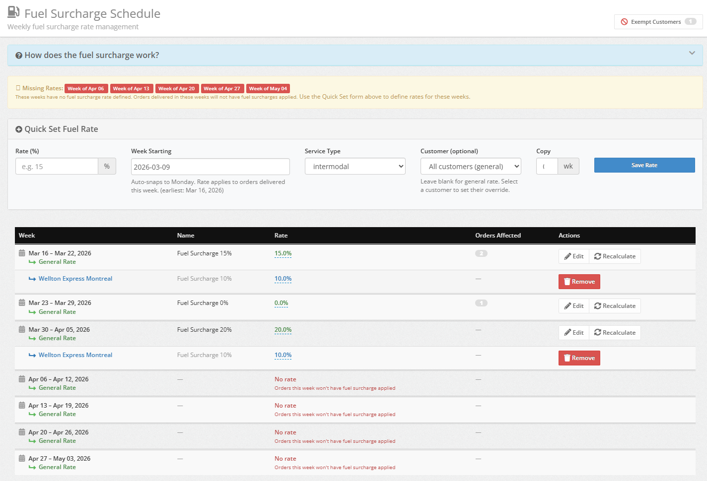
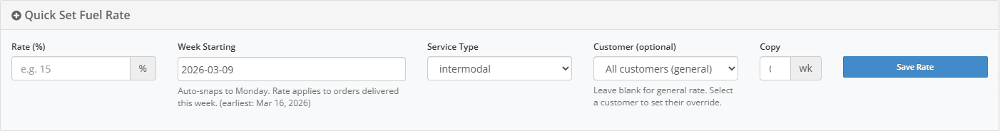
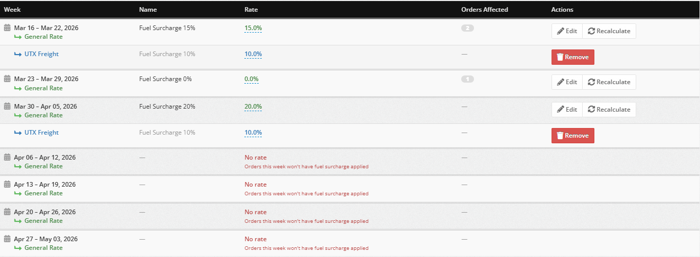
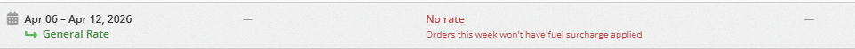
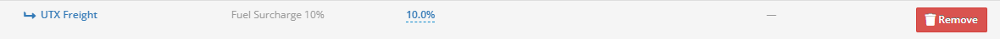
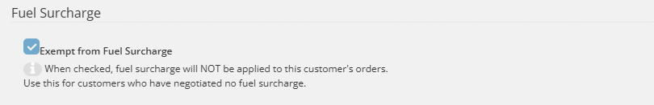
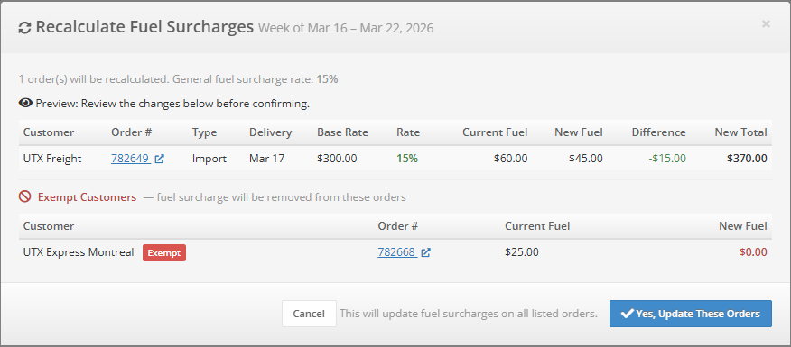
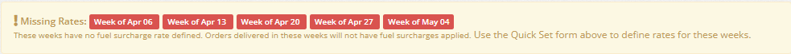

# Fuel Surcharge

Set monthly fuel surcharge rates, per-customer overrides and exemptions on the **Fuel Schedule** page. UTX Freight applies the right rate to qualifying orders automatically.

## :fontawesome-solid-gas-pump: Overview

The **fuel surcharge** is a percentage of an order's base rate. UTX Freight adds it automatically to **Import**, **Export** and **Transfer** orders that have **Auto compute fuel surcharges for this order** set to **Yes**. You set the rate once per month, and the system does the rest.

Here is how it works at a glance:

- :fontawesome-solid-puzzle-piece: **Add-on feature** -- the Fuel Schedule exists only when your system has the **fuel surcharge add-on**.
- :fontawesome-solid-calendar-days: **Rates are monthly** -- each rate covers one full calendar month. There are no weekly rates.
- :fontawesome-solid-truck: **The order's delivery date** decides which month's rate applies.
- :fontawesome-solid-building: **Customer overrides** let you set a different rate for a specific customer in a given month.
- :fontawesome-solid-ban: **Exempt customers** get no fuel surcharge at all.
- :fontawesome-solid-rotate: **Recalculate** updates every open order in a month in one step, after a preview.
- :fontawesome-solid-lock: **Completed or invoiced orders are never changed.**

## :fontawesome-solid-bolt: Quick Start

Already familiar with fuel surcharges? Here is the fastest path to setting a rate:

1. Click :fontawesome-solid-gas-pump: **Fuel Schedule** in the left menu.
2. In **Quick Set Fuel Rate**, enter the **Rate (%)** and pick the **Month**.
3. Leave **Customer (optional)** on **All customers (general)**.
4. Click **Save Rate**.

The rate is now live for that month. Orders delivered in that month pick it up the next time they are created or saved.

!!! tip "Tip"
    Changed a rate after orders were already created? Click **Recalculate** on that month's row to update all open orders at once.

---

## :fontawesome-solid-shield-halved: Access & Permissions

The Fuel Schedule page requires the **fuel surcharge add-on** and one of these roles:

| Role | Access Level |
| ---- | ---- |
| :fontawesome-solid-user-shield: **Admin** | Full access |
| :fontawesome-solid-user-tie: **Manager** | Full access |
| :fontawesome-solid-file-invoice-dollar: **Accountant** | Full access |
| :fontawesome-solid-warehouse: **Warehouse** | Full access |
| :fontawesome-solid-headset: **Dispatch** | Only with **Can manage rates?** checked on their profile |
| :fontawesome-solid-wrench: **Garage**, customers, drivers | No access |

**Can manage rates?** is a checkbox on the dispatcher's profile. See [People & Invitations](people-and-invitations.md) and [User Roles](user-roles.md).

**How to get there:**

- :fontawesome-solid-arrow-right: Click **Fuel Schedule** (:fontawesome-solid-gas-pump: icon) in the **left menu**. It is its own top-level item, just below **Invoices**. It is **not** under Charges or the Charge Types page.

!!! warning "Can't find Fuel Schedule?"
    - If your system does not have the fuel surcharge add-on, the menu item is hidden. Opening the page directly sends you to the **Charge Types** list with the message **Fuel surcharge addon is not enabled.** See [Add-ons & Options](add-ons-and-options.md).
    - If you are a dispatcher, ask an administrator to check **Can manage rates?** on your profile.

### :fontawesome-solid-heading: Page header and help panel

The page is titled **Fuel Surcharge Schedule** with the subtitle **Monthly fuel surcharge rate management**. On the right of the header is the **Exempt Customers** button (see [Viewing all exempt customers](#viewing-all-exempt-customers)).

Below the header, a blue panel titled **How does the fuel surcharge work?** is collapsed by default. Click it to open a short built-in guide covering when the surcharge is applied, how rates are matched, overrides and exemptions, the calculation, missing rates, recalculating and reading the table.

---

## :fontawesome-solid-pencil: Setting a Fuel Rate

Use the **Quick Set Fuel Rate** form near the top of the page to create or update a rate.

### :fontawesome-solid-rectangle-list: Quick Set Fuel Rate fields

| Field | What It Does |
| ---- | ---- |
| :fontawesome-solid-percent: **Rate (%)** | Required. The surcharge percentage. Enter `15` for 15%. Must be **above 0** and **at most 100**. Decimals such as `15.5` are allowed. |
| :fontawesome-solid-calendar-days: **Month** | Required. A date picker, pre-filled with the 1st of the current month. Whatever day you pick is snapped to the **1st of that month** (help text: *The rate will apply starting the 1st of the selected month.*). |
| :fontawesome-solid-truck: **Service Type** | Defaults to **intermodal**. It is stored with the rate but has **no effect** on which orders get the rate. Saving a rate for a month that already has one overwrites it, whatever service you pick. |
| :fontawesome-solid-building: **Customer (optional)** | Leave on **All customers (general)** for the general rate (help text: *Leave blank for general rate.*). Pick an active customer to save a **customer override** instead. |
| :fontawesome-solid-copy: **Copy Fwd** | Number of extra months (**mo**) to copy the same rate into, from 0 to 12. Defaults to 0. A value of **N** saves **N + 1** months: the selected month plus the next N. |

### Step-by-step: Create or update a monthly rate

1. :fontawesome-solid-arrow-right: Click **Fuel Schedule** in the left menu.
2. :fontawesome-solid-percent: Enter the **Rate (%)** -- for example, `15`.
3. :fontawesome-solid-calendar-days: Pick any day in the **Month** you want.
4. :fontawesome-solid-building: Leave **Customer (optional)** on **All customers (general)** for a general rate.
5. :fontawesome-solid-copy: Optionally enter a number in **Copy Fwd** to repeat the rate for following months.
6. :fontawesome-solid-circle-check: Click **Save Rate** (it shows **Saving...** while working).

You see a message such as **Saved general rate for 4 month(s).** or, for an override, **Saved _Customer Name_ override for 1 month(s).**

If a rate already exists for that month (and the same customer, or general), it is **updated**, not duplicated. **Copy Fwd** overwrites existing rates in the following months too.

!!! tip "Time Saver"
    If your rate stays the same for the next few months, set **Copy Fwd** to `3` and four months are saved in one click.

### :fontawesome-solid-tag: Rate names

Each rate is named automatically **Fuel Surcharge N%**, where N is the rate with the decimals **cut off** (not rounded). A 15.5% rate is named **Fuel Surcharge 15%**, but the **Rate** column shows `15.5%` and the full 15.5% is used in the calculation. The name updates itself whenever the rate changes.

### :fontawesome-solid-triangle-exclamation: Messages you may see

| Message | Meaning |
| ---- | ---- |
| **Saved general rate for N month(s).** | General rate saved for N months. |
| **Saved _Customer_ override for N month(s).** | Customer override saved for N months. |
| **Invalid company selected.** | The selected customer does not belong to your office. Nothing was saved. |
| **Invalid date provided.** | The **Month** value could not be read as a date. Nothing was saved. |

A rate of 0, a negative rate, or a rate above 100 is rejected and not saved.

---

## :fontawesome-solid-table: Understanding the Schedule Table

The table shows a fixed **9-month window**: the **2 previous months**, the **current month**, and the **next 6 months**. Months are listed oldest first.

| Column | What It Shows |
| ---- | ---- |
| **Month** | The month name, with **General Rate** in green underneath. The current month has an arrow and a **Current** label. |
| **Name** | The rate's name, such as **Fuel Surcharge 15%**, or **—** when there is no general rate. |
| **Rate** | The general rate in green, always shown with decimals (for example `15.0%`). Click it to edit for current and future months. When there is no general rate: **No rate** in red with *Orders this month won't have fuel surcharge applied*. |
| **Orders Affected** | A badge with the number of open, non-exempt orders delivered that month. Shown only when the month has a general rate. May also show a red exempt note (see below). |
| **Actions** | **Edit** and **Recalculate** buttons (see below). |

Customer override rows appear indented under their month's general rate, sorted by customer name.

### :fontawesome-solid-palette: Color Guide

#### :fontawesome-solid-circle:{ .text-success } Green -- General Rate

The **General Rate** is the default rate for **all customers** that month. Customers without an override use it.

#### :fontawesome-solid-circle:{ .text-primary } Blue -- Customer Override

A **blue customer name** on a grey indented row is a **custom rate** for that customer in that month. It takes priority over the general rate.

#### :fontawesome-solid-circle:{ .text-danger } Red -- Attention Needed

- **No rate** -- no general rate is defined for that month.
- **(N exempt — charges pending removal)** -- N open orders of exempt customers still carry fuel charges. Recalculate the month to clear them.

### :fontawesome-solid-circle-info: Other visual indicators

- :fontawesome-solid-tag: **Current** -- a blue label, bold text and a highlighted row mark the current month.
- :fontawesome-solid-eye-slash: **Faded rows** -- past months are faded and their rates cannot be edited inline.
- :fontawesome-solid-grip-lines: **Double borders** -- a double line separates each month.

### :fontawesome-solid-hashtag: Orders Affected and the exempt note

- The **badge** counts **open orders** (see [Which orders count as open](#which-orders-count-as-open)) delivered in that month for customers who are **not exempt**. It includes customers who have an override. Override rows themselves show **—**.
- The badge appears only when the month has a general rate and at least one such order.
- The red **(N exempt — charges pending removal)** note counts open orders for **exempt** customers that still have a fuel charge. It can appear even in a month with **No rate**.

### :fontawesome-solid-hand-pointer: Action buttons

| Month | General rate exists | Buttons shown |
| ---- | ---- | ---- |
| Current or future | Yes | **Edit**, **Recalculate** |
| Current or future | No, but exempt charges are pending | **Recalculate** only |
| Current or future | No, and nothing pending | None |
| Past | Yes | **Edit** only |
| Past | No | None |

Customer override rows show a red **Remove** button for current and future months only.

---

## :fontawesome-solid-pen-to-square: Editing a Rate

### Inline edit (current and future months)

1. :fontawesome-solid-hand-pointer: Click the rate value (the green general rate or a blue override rate).
2. :fontawesome-solid-keyboard: In the **Enter new rate (%)** pop-up, type the new rate.
3. :fontawesome-solid-circle-check: Confirm. The page reloads with the new rate and name.

The same rule applies: above 0, at most 100.

### The Edit button

**Edit** on a general rate row opens the full charge type form (**Order Charge Information**). It is available for **past months too**, even though past rates cannot be edited inline. Rates in the **Historical Rates** table also have an **Edit** button. Override rows have no **Edit** button; change their rate inline.

After you click **Save** in that form, you land on the **Charge Types** list (where fuel rates are hidden). Click **Back to Fuel Schedule** to return.

!!! warning "Applicable on (Month)"
    A rate is matched to orders by month, so **Applicable on (Month)** should always be the **1st of a month**. If you change it, pick the 1st.

!!! info "Changing a rate does not change orders by itself"
    Saving a new rate, by any method, does not touch existing orders. They pick up the new rate the next time they are saved, or all at once when you click **Recalculate** (current and future months only).

---

## :fontawesome-solid-building: Customer Overrides (Custom Rates)

Need a different rate for one customer? Create an **override** for that month.

### Step-by-step: Set a custom rate for a customer

1. :fontawesome-solid-arrow-right: Click **Fuel Schedule** in the left menu.
2. :fontawesome-solid-building: In **Quick Set Fuel Rate**, pick the customer in **Customer (optional)**.
3. :fontawesome-solid-percent: Enter the **Rate (%)**.
4. :fontawesome-solid-calendar-days: Pick the **Month**, and optionally set **Copy Fwd**.
5. :fontawesome-solid-circle-check: Click **Save Rate**.

The override appears indented under that month's general rate. For orders of that customer delivered in that month, the override is used instead of the general rate. The order's fuel charge note then reads **Computed Fuel Surcharge N% (custom rate for _Customer_)**.

!!! info "Overrides are month by month"
    An override covers only the months you saved it for. Use **Copy Fwd** to cover several months. A month with an override but no general rate still appears in the **Missing Rates** banner, because the banner checks general rates only.

### :fontawesome-solid-trash: Removing an override

1. Click the red **Remove** button on the override row (current and future months only).
2. Confirm **Remove fuel surcharge override for _Customer_?**

What happens next:

- If orders already have fuel charges linked to the override, those charges are moved to that month's **general rate**. Their **amounts do not change** until the orders are recalculated or saved.
- If there are linked charges **and no general rate** for that month, nothing is removed and you see **Cannot delete override: it has linked charges and no general rate exists for this month.** Set a general rate first.
- On success you see **Removed fuel surcharge override for _Customer_.** If that customer has open orders in the month, the message adds **N open order(s) for this customer may need recalculation — use the Recalculate button for _Month Year_.**

!!! warning "Recalculate after removing an override"
    Click **Recalculate** on that month so the customer's open orders move to the general rate amount.

---

## :fontawesome-solid-ban: Exempting a Customer

Some customers have agreements with no fuel surcharge. Mark them as **exempt**.

### Step-by-step: Exempt a customer

1. :fontawesome-solid-arrow-right: Open the customer list and click **Edit** on the customer. See [Managing Customers](managing-customers.md).
2. :fontawesome-solid-gas-pump: Find the **Fuel Surcharge** section (shown only with the add-on).
3. :fontawesome-solid-square-check: Check **Exempt from Fuel Surcharge**. Its hint reads: *When checked, fuel surcharge will NOT be applied to this customer's orders. Use this for customers who have negotiated no fuel surcharge.*
4. :fontawesome-solid-circle-check: Click **Save Changes**.

You return to the customer list with **Customer was successfully updated.** If you just turned the exemption on and the customer has open (not completed, not invoiced) orders that already carry fuel charges, a yellow warning also appears:

> **_Customer_ has N open order(s) with fuel surcharges that need recalculation. Visit the Fuel Schedule to recalculate.**

!!! danger "Exempting does not clean up existing orders by itself"
    Existing fuel charges stay on the customer's open orders until each order is saved again or you click **Recalculate** for the affected month(s). On the next save of an open Import, Export or Transfer order with auto-compute on, the exempt customer's fuel charge is removed.

To remove an exemption, uncheck the box and click **Save Changes**. Open orders get a fuel charge again the next time they are saved or recalculated.

### :fontawesome-solid-eye: Viewing all exempt customers { #viewing-all-exempt-customers }

Click **Exempt Customers** in the top-right of the Fuel Schedule page. The badge on the button shows how many active customers are exempt.

The **Exempt Customers** window lists them (**Customer Name**, with an **Edit** button for each) under the line *These customers will not have fuel surcharge applied to their orders.* If none are exempt, it says **No customers are currently exempt from fuel surcharge.**

---

## :fontawesome-solid-triangle-exclamation: Stale Charges on Exempt Customers

When a customer is exempt but their open orders still carry fuel charges, those charges are **stale**. The schedule flags them in red on the month's row:

!!! info "Example"
    (3 exempt — charges pending removal)

**How to fix it:** click :fontawesome-solid-rotate: **Recalculate** on that month's row (the button appears for current and future months even when the month has no general rate). The preview lists those orders under **Exempt Customers**, and confirming removes their fuel charges.

---

## :fontawesome-solid-rotate: Recalculating Fuel Charges

**Recalculate** re-runs the charge calculation on every open order delivered in a month, so they all use the current rate.

### Step-by-step: Recalculate a month

1. :fontawesome-solid-arrow-right: On the Fuel Schedule page, find the current or future month.
2. :fontawesome-solid-rotate: Click **Recalculate** on that month's row.
3. :fontawesome-solid-eye: Review the **Recalculate Fuel Surcharges** preview (subtitle **Month of _Month Year_**).
4. :fontawesome-solid-circle-check: Click **Yes, Update These Orders**, or **Cancel** to close without changes.

You return to the Fuel Schedule with **Recalculated charges for N open order(s) in _Month Year_.**

<!-- TODO: Screenshot — Recalculate Fuel Surcharges preview modal showing the main orders table and the summary line -->

### :fontawesome-solid-table-list: What the preview shows

At the top: **N order(s) will be recalculated.** (non-exempt orders only), then **General fuel surcharge rate: N%** (or **No general fuel surcharge rate is defined for this month.** in red), and, when relevant, **N order(s) use a custom company rate.**

The main table (under **Preview: Review the changes below before confirming.**) lists non-exempt open orders, sorted by customer and delivery date:

| Column | What It Shows |
| ---- | ---- |
| **Customer** | The order's customer. |
| **Order #** | The order number. The link opens the **Orders** list searched for that number in a new tab -- not the order itself. |
| **Type** | Import, Export or Transfer. |
| **Delivery** | Delivery date (e.g. `Oct 14`). |
| **Base Rate** | The order's base rate. |
| **Rate** | The fuel % that will apply: green for the general rate, blue with a **Custom** label for an override. Shown as a whole number. |
| **Current Fuel** | The fuel amount on the order now. |
| **New Fuel** | The fuel amount after recalculation. |
| **Difference** | Orange with **+** for an increase, green for a decrease, grey for no change. |
| **New Total** | The expected order total after recalculation. |

If exempt customers have fuel charges in that month, a second section appears: **Exempt Customers** — *fuel surcharge will be removed from these orders*. Its columns are **Customer** (with a red **Exempt** label), **Order #**, **Current Fuel** and **New Fuel** (always **$0.00**).

The footer reads *This will update fuel surcharges on all listed orders.* next to the **Yes, Update These Orders** button.

If there is nothing to do, the preview says **No open orders found for this month. There is nothing to recalculate.** and *Only import, export, and transfer orders that are not completed or invoiced are included.* The confirm button is not shown.

### :fontawesome-solid-circle-info: What recalculation actually does

- Each open order in the month (exempt or not) is saved again with a full charge refresh. This also refreshes the automatic **Terminal Fee** (Import and Export orders) and the order **total**, not just fuel.
- **Orders with Auto compute fuel surcharges for this order set to No are skipped for fuel.** Their fuel charge does not change -- including exempt customers' orders.
- **Completed and invoiced orders are never changed.**
- If the month has **no rate at all** (no general rate and no override for the customer), existing fuel charges on non-exempt orders are **kept as they are**.

!!! warning "Past months cannot be recalculated"
    Past months have no **Recalculate** button. To fix a past month, open and save the orders one by one (if they are still open), or adjust their charges individually. See [Order Charges & Expenses](order-charges-and-expenses.md).

---

## :fontawesome-solid-calculator: How the Fuel Amount Is Calculated

!!! info "Formula"
    Base Rate x Fuel Rate % = Fuel Surcharge Amount, rounded to the nearest cent.

**Example:** base rate **$1,000**, fuel rate **15%** → **$150.00** fuel surcharge.

The charge is added to the order's charges with the note **Computed Fuel Surcharge 15%** (or **Computed Fuel Surcharge 15% (custom rate for _Customer_)** for an override). The % in the note is a whole number, but the exact rate is used for the amount.

### :fontawesome-solid-list-check: Calculation rules

| Rule | Detail |
| ---- | ---- |
| **When fuel is computed** | When an order is created, each time it is saved from the order or dispatch forms, when its return terminal is changed inline, when an order is duplicated, and when you click **Recalculate**. |
| **Order types** | **Import**, **Export** and **Transfer** only. |
| **Auto-compute** | **Auto compute fuel surcharges for this order** must be **Yes** (the default for new orders). |
| **Open orders only** | Not **Completed** and not invoiced. After that the fuel charge is final. |
| **Which month** | The month of the order's **delivery date**. An order with no delivery date gets no new fuel charge, and any existing one is left as it is. |
| **Which rate** | The customer's override for that month if there is one, otherwise the general rate. |
| **Replacement** | The previous fuel charge is removed and replaced on every computation. Manual edits to it are overwritten. |
| **Exempt customers** | Any fuel charge is removed and none is added. |
| **No rate for the month** | Nothing is changed: no fuel charge is added, and an existing one is left as it is. |

!!! info "Delivery date decides the month"
    If you move an order's delivery date into another month, the next save uses the new month's rate.

### :fontawesome-solid-door-open: Which orders count as open { #which-orders-count-as-open }

For **Orders Affected**, the exempt note and **Recalculate**, an order counts as open when it is:

- in the office you are working in,
- not invoiced,
- not **Completed**,
- an **Import**, **Export** or **Transfer** order,
- delivered (by **delivery date**) within that calendar month.

---

## :fontawesome-solid-circle-exclamation: Missing Rates Warning

If the **current month or any of the next 5 months** has no **general** rate, an **amber** banner appears near the top of the page: **Missing Rates:** followed by a red label for each month, and *These months have no fuel surcharge rate defined. Orders delivered in these months will not have fuel surcharges applied.*

Customer overrides do **not** count -- a month is listed until it has a general rate.

!!! tip "Stay Ahead"
    Set rates a few months in advance with **Copy Fwd** so the banner stays empty.

---

## :fontawesome-solid-clock-rotate-left: Historical Rates (before March 2026)

The monthly Fuel Schedule replaced the old setup in **March 2026**. **Weekly fuel rates no longer exist**: all older weekly rates were converted to monthly rates, keeping one rate per month (per customer and office). If that month already had a monthly rate, it was kept; otherwise the earliest week's rate was kept. Existing order charges were moved to the kept rate, and their amounts were not changed.

If your account has general rates dated **before March 2026**, a **Historical Rates (before March 2026)** panel appears at the bottom of the page. It shows the **6 most recent** of them, with the columns **ID**, **Name**, **Month**, **Rate**, **Service** and **Actions** (**Edit**).

These rates only matter for orders delivered in those months. Set all new rates with **Quick Set Fuel Rate**.

---

## :fontawesome-solid-link: Related Features

- :fontawesome-solid-list-check: **Setup checklist** -- with the add-on, the onboarding checklist has the step **Set this month's fuel surcharge** (button **Open Fuel Schedule**). It is done only when the **current month** has a general rate, so it reopens at the start of every month: last month's rate does not carry forward. See [Setup Checklist](setup-checklist.md).
- :fontawesome-solid-file-invoice-dollar: **Charge Types** -- monthly fuel rates are stored as charge types but are **hidden** from the Charge Types list when the add-on is on. That page shows a **Back to Fuel Schedule** button. See [Charge Types, Expense Types & Taxes](charge-types-and-taxes.md).
- :fontawesome-solid-receipt: **Order charges** -- how the fuel charge appears on an order and the **Auto compute fuel surcharges for this order** setting. See [Order Charges & Expenses](order-charges-and-expenses.md).

---

## :fontawesome-solid-circle-question: FAQ / Troubleshooting

### :fontawesome-solid-ban: Customer was exempted but still has fuel charges

!!! info "Solution"
    Exempting does not remove existing charges by itself. On the **Fuel Schedule**, find the month(s) with the red **charges pending removal** note and click **Recalculate**. The orders appear under **Exempt Customers** in the preview with **New Fuel** at $0.00. If an order still keeps its charge, check that **Auto compute fuel surcharges for this order** is **Yes** -- orders with auto-compute off are skipped.

### :fontawesome-solid-lock: No Recalculate button for a past month

!!! info "Solution"
    By design, **Recalculate** only appears on the current and future months. Past months only have **Edit**. Fix past-month orders individually.

### :fontawesome-solid-rotate: Rate was changed but orders still show the old amount

!!! info "Solution"
    Changing a rate does not update existing orders. Click **Recalculate** on that month, review the preview, then click **Yes, Update These Orders**.

### :fontawesome-solid-building: Customer has a custom rate but orders use the general rate

!!! info "Solution"
    Check that the override is saved for the **month of the order's delivery date** (overrides are per month). If the override was added after the orders were saved, click **Recalculate**. The **Service Type** does not matter.

### :fontawesome-solid-circle-xmark: An order has no fuel surcharge

!!! info "Solution"
    Check that: the month of the delivery date has a rate; the order is **Import**, **Export** or **Transfer**; **Auto compute fuel surcharges for this order** is **Yes**; the customer is not exempt; the order is not completed or invoiced. Then save the order or recalculate the month.

### :fontawesome-solid-gas-pump: An order still has a fuel charge in a month with "No rate"

!!! info "Solution"
    When a month has no rate, existing fuel charges are left untouched (they are not set to zero). Set a rate for the month and recalculate, or remove the charge from the order manually.

### :fontawesome-solid-copy: I picked a different Service Type and my old rate was replaced

!!! info "Solution"
    Expected. There is one general rate per month (and one override per customer per month). **Service Type** does not create a separate rate.

### :fontawesome-solid-trash: "Cannot delete override" when removing a custom rate

!!! info "Solution"
    The override is already used by order charges and the month has no general rate to move them to. Set a general rate for that month with **Quick Set Fuel Rate**, then click **Remove** again.

### :fontawesome-solid-arrow-up-right-from-square: Clicking an order number in the preview opens a search

!!! info "Solution"
    By design, the link opens the **Orders** list searched for that order number in a new tab. Open the order from there.

### :fontawesome-solid-lightbulb: Tips for managing fuel surcharges

!!! tip "Best Practices"
    **Set rates early.** Use **Copy Fwd** so the **Missing Rates** banner stays empty.

    **Watch for red.** **No rate** and **charges pending removal** always need attention.

    **Recalculate after changes.** After changing a rate, exempting a customer or removing an override, recalculate the affected current and future months.

    **Read the preview.** Check the **Difference** column before clicking **Yes, Update These Orders**.
