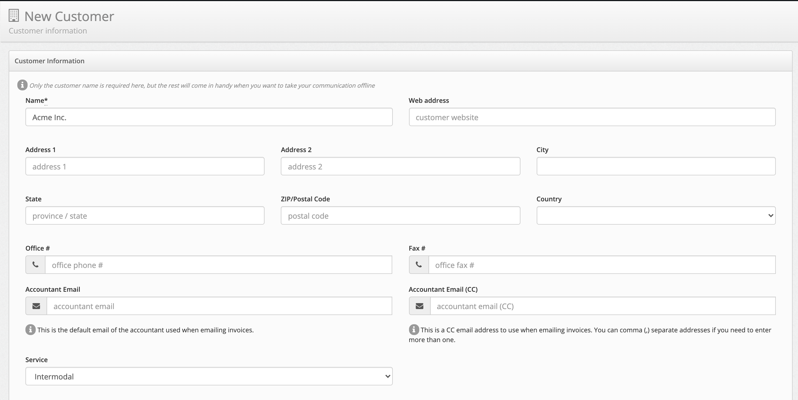
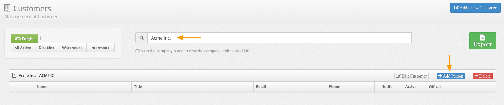
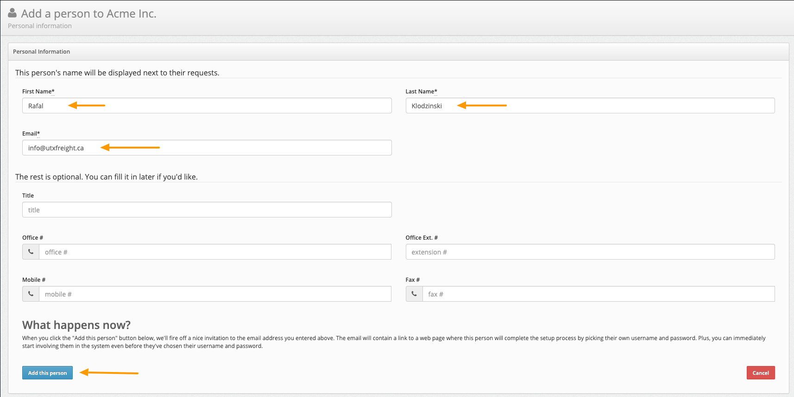
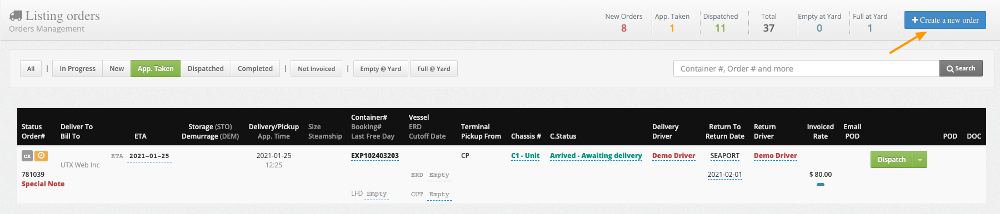
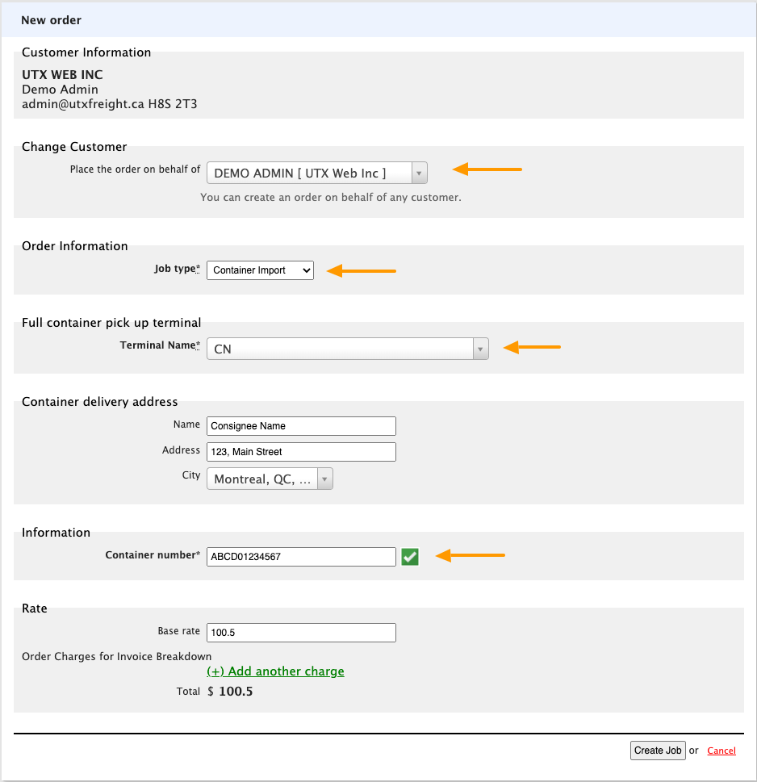

# Getting Started

Set up a new UTX Freight account by hand and take your first order from creation to invoice.

## :fontawesome-solid-rocket: Overview

A new account needs a few things in place before the first order can be priced, dispatched and invoiced. This page walks through them in order:

- :fontawesome-solid-dollar-sign: **Prices**: zone prices, delivery cities assigned to zones, terminal default rates and, if you have the fuel surcharge add-on, this month's fuel surcharge. Without them an order prices at **$0.00**.
- :fontawesome-solid-building: **A customer**: the company you haul for.
- :fontawesome-solid-user: **A contact** at that customer. Every order is placed on behalf of a person, not just a company.
- :fontawesome-solid-truck-moving: **Your yard**: at least one chassis and one driver, so the order can be dispatched.
- :fontawesome-solid-file-invoice: **Your tax numbers**: GST, QST and NIR, printed on invoices and proofs of delivery.
- :fontawesome-solid-truck: **The first order**: create it, dispatch it, invoice it.

!!! tip "Use the in-app checklist"
    Admins and Managers see a setup checklist entry at the top of the left menu. On a new account it reads **Getting started**. Once the account has issued at least one invoice it reads **Setup check**, and when every required step is done it reads **Setup complete** with a green check. The checklist checks your data, shows which steps are still missing, and has a button for each step that opens the right screen. See [Setup Checklist](setup-checklist.md).

---

## :fontawesome-solid-bolt: Quick Start

1. Set your prices. Open your name at the top of the screen, then use **Manage Zones**, **Manage Cities** (assign a zone to each city you deliver to), **Manage Terminals** (default rate) and **Charge Types** (set one charge type's **Use as default for** to **Terminal Fee**). If the fuel surcharge add-on is on, set this month's rate in **Fuel Schedule** in the left menu.
2. Go to **Customers** and click **Add a new Customer**. Enter the **Name** and click **Save Changes**.
3. On the **Customers** list, find the company and click :fontawesome-solid-plus: **Add Person**. Enter **First Name**, **Last Name** and **Email**, then click **Add this person**.
4. Add one chassis in **Equipments** and one driver in **Mobile Users** > **Drivers, Brokers & Yard**.
5. Admins only: open your name > **Settings** > **Edit settings** and fill in **GST Number**, **QST Number** and **NIR Number**.
6. Go to **Orders**, click :fontawesome-solid-plus: **Create a new order**, pick the contact in **Place the order on behalf of**, choose the **Job type**, fill in the order and click **Create Job**.
7. Dispatch the order to your driver from **Dispatch**, then create the invoice from **Invoices**.

---

## :fontawesome-solid-shield-halved: Access & Permissions

| Step | Who can do it |
|------|---------------|
| Set zone, city, terminal and charge type prices | :fontawesome-solid-user-shield: **Admin**, :fontawesome-solid-user-tie: **Manager** |
| Create a customer and add people | :fontawesome-solid-user-shield: **Admin**, :fontawesome-solid-user-tie: **Manager**. :fontawesome-solid-headset: **Dispatch** only if your account has dispatcher customer management turned on (off by default; ask UTX support). |
| Set a person's role (staff logins) | :fontawesome-solid-user-shield: **Admin** only |
| Add equipment and drivers | :fontawesome-solid-user-shield: **Admin**, :fontawesome-solid-user-tie: **Manager**, :fontawesome-solid-headset: **Dispatch** |
| Enter GST, QST and NIR numbers (**Settings**) | :fontawesome-solid-user-shield: **Admin** only |
| Create an order | :fontawesome-solid-user-shield: **Admin**, :fontawesome-solid-user-tie: **Manager**, :fontawesome-solid-headset: **Dispatch**. :fontawesome-solid-file-invoice-dollar: **Accountant** if your account allows accountants to manage orders (on by default). :fontawesome-solid-user: **Customer** only if your account has customer order entry turned on (off by default; ask UTX support). |
| Choose who the order is for (**Place the order on behalf of**) | Admin, Manager and Dispatch. Anyone else creates the order for themselves. |
| See the setup checklist | Admin and Manager |

The **Customer Service** role has the same access as **Dispatch** everywhere in this table. Options such as dispatcher customer management and customer order entry are turned on for your account by UTX support. See [Add-ons and Options](add-ons-and-options.md) and [User Roles](user-roles.md).

---

## :fontawesome-solid-dollar-sign: Step 1: Set Your Prices

UTX Freight prices an order by looking up the delivery city, reading which zone it is in, and taking that zone's price. Do this before the first order: an order whose delivery city has no zone price is priced at **$0.00**.

The screens below are in the menu under your name at the top of the screen (**Manage Zones**, **Manage Cities**, **Manage Terminals**, **Charge Types**).

1. **Zone prices**: open **Manage Zones** and enter the price you charge for a delivery into each zone you use. Zones start at $0.00. Disable the zones you do not use.
2. **Cities in zones**: open **Manage Cities**, click the **Shipping** filter (cities where at least one order has been delivered), and set the zone on each city you deliver to. A city with no zone prices at $0.00.
3. **Terminal fees**: open **Charge Types**, edit the charge you bill for terminals and set **Use as default for** to **Terminal Fee**. Then open **Manage Terminals** and enter a **Default Rate** on the terminals you pull from. That rate is added as a charge to every order using the terminal. Without both, terminal fees never appear on an invoice.
4. **Fuel surcharge** (only if the fuel surcharge add-on is on): open **Fuel Schedule** in the left menu and enter the percentage for the current month. With no rate for the month, orders are built without a fuel charge. The rate does not carry forward, so set it again each month.

Details: [Zones and Cities](zones-and-cities.md), [Managing Terminals](managing-terminals.md), [Charge Types and Taxes](charge-types-and-taxes.md), [Fuel Surcharge](fuel-surcharge.md).

!!! info "Negotiated prices"
    A price agreed with one customer is set later on that customer's record and overrides the zone price for that customer only. It shows in blue so nobody mistakes it for the standard rate. See [Managing Customers](managing-customers.md).

---

## :fontawesome-solid-building: Step 2: Create Your First Customer

All orders in UTX Freight are placed on behalf of a contact :fontawesome-solid-user: **Person** from a :fontawesome-solid-building: **Customers** company, so the first step is to create the customer company.

1. From the left menu, select :fontawesome-solid-building: **Customers**.
2. Click **Add a new Customer** at the top right.
3. Enter the **Name**. It is the only required field.
4. If your account has the warehouse or garage add-on, the **Service** field offers more than one choice. Keep **Intermodal** (or **Intermodal & Warehouse**) for a company you haul for. Only people at companies with the Intermodal service can be picked on a new order.
5. Click **Save Changes**.

### Finding a customer on the list

The **Customers** page opens on your own company. Use the search box labelled **Filter companies and users**: type at least two characters of a company name, or of a person's first name, last name or email, to narrow the list. The filter tabs on the left change which companies are listed:

| Tab | Shows |
|-----|-------|
| *Your company name* | Your own company (where your office staff logins live) |
| **All Active** | Active customer companies |
| **Disabled** | Disabled customer companies |
| **Brokers** | Companies marked as brokers |

If the warehouse add-on is on, **Warehouse** and **Intermodal** tabs are also shown.

---

## :fontawesome-solid-user-plus: Step 3: Add a Contact Person

Once the customer exists, add a contact :fontawesome-solid-user: **Person** for it. Orders are attached to people, and a customer with no contact cannot be ordered for.

1. From the left menu, select :fontawesome-solid-building: **Customers**.
2. In **Filter companies and users**, type the company name.
3. On the company row, click :fontawesome-solid-plus: **Add Person**.

4. Fill in **First Name**, **Last Name** and **Email**. **Title**, **Office #**, **Office Ext. #**, **Mobile #** and **Fax #** are optional.
5. Click **Add this person**.

!!! warning "An invitation email is sent immediately"
    Clicking **Add this person** emails an **Invitation instructions** message to the address you entered. To set someone up quietly, use a placeholder address such as `customername+1@yourdomain.com` and change it later.

### What the invited person sees

1. They receive the **Invitation instructions** email with an **Accept invitation** link.
2. The link opens a page where they confirm their first and last name, choose a password, confirm it, and click **Create your account**.
3. They are signed in. You can attach orders to them before they accept.

### Roles: everyone starts as a Customer

Every person added with **Add Person** is created with the **Customer** role, including people you add to your own company. To give office staff a staff role (Dispatch, Accountant, Manager, and so on):

1. Add them with **Add Person** under **your own company** on the **Customers** list.
2. An **Admin** opens their **Edit Person** page, picks the **Role**, and clicks **Save Changes**.

The **Role** field is only shown to Admins, and only for people in your own company. See [People and Invitations](people-and-invitations.md) and [User Roles](user-roles.md).

!!! info "Customer logins and orders"
    A Customer-role person can log in and see their company's orders. They can only create orders themselves if your account has customer order entry turned on (ask UTX support). See [Customer Portal](customer-portal.md).

### Notification emails

When an order is dispatched or completed, the person it was placed for gets an email, but only while **Email Notifications** is ticked on their **Edit Person** page. The box is ticked by default for new people. Untick it for anyone who should not receive these emails. See [Notifications and Emails](notifications-and-emails.md).

---

## :fontawesome-solid-truck-moving: Step 4: Set Up Your Yard

An order is dispatched onto a piece of equipment and to a driver. Before you dispatch, add at least:

- **One chassis**: open **Equipments** and add one unit with its **Name/Number**, **Type** and plate number. See [Equipment](equipment.md).
- **One driver**: open **Mobile Users** > **Drivers, Brokers & Yard**, click **Add a new mobile user**, set the **Role** to Driver and click **Save**. Note the **Access Code**: that is what the driver enters in the phone app, and only active drivers can use it. See [Mobile Users](mobile-users.md).

---

## :fontawesome-solid-receipt: Step 5: Add Your Tax Numbers

Your registration numbers are printed on every invoice and proof of delivery, and they start blank. Only an **Admin** can change them.

1. Open your name at the top of the screen, then **Settings**.
2. Click **Edit settings**.
3. Under **Invoice Settings**, enter your **GST Number** and **QST Number**.
4. Under **POD Settings**, enter your **NIR Number**.
5. Click **Save Changes**.

These are your own registration numbers, not tax rates. See [Application Settings](application-settings.md).

---

## :fontawesome-solid-truck: Step 6: Create Your First Order

1. From the left menu, select :fontawesome-solid-truck: **Orders**.
2. Click :fontawesome-solid-plus: **Create a new order**.

3. Under **Change Customer**, pick the contact in **Place the order on behalf of**. The list shows **people**, written as `PERSON NAME [ Company ]`, not companies. Only active people at active Intermodal companies are listed. The order is created for whoever is selected here, so check it before you submit. This field is shown to Admin, Manager and Dispatch only; other users create the order for themselves.
4. Under **Order Information**, choose the order type in **Job type**. Start with **Container Import**. The rest of the form appears only after you choose a type.
5. For an Import or Export, choose the **Terminal Name** in the pick-up terminal section. For an Import it is titled **Full container pick up terminal**; for an Export, **Empty container pick up terminal**.
6. Fill in the delivery address (titled **Container delivery address** for an Import). Choosing the delivery **City** is what looks up the zone and the price.
7. Enter the **Container number** under **Information**.
8. Click **Create Job** at the bottom of the form.

<!-- TODO: Screenshot — order form showing "Change Customer" / "Place the order on behalf of" and the Job type dropdown -->

### Required fields

| Field | Required when |
|-------|---------------|
| **Container number** (shown as **Trailer number** for a Dry Van Move) | Always |
| **Job type** | Always |
| **Terminal Name** (pick-up terminal) | Import and Export orders |

Everything else is optional for saving the order, but the delivery city is what prices it. If the price shows **$0.00**, go back to Step 1 above. Full field reference: [Order Form](order-form.md).

### Order types

The types offered in **Job type** depend on your account. By default only **Container Import** and **Container Export** are enabled. Other accounts may also have **Container Transfer**, **Dry Van Move** or **International Export**. Ask UTX to enable a type you need.

!!! danger "Suspended accounts cannot create orders"
    If your account is suspended, the **Create a new order** button turns red and opens a notice instead of the order form, and new orders are blocked. See [Add-ons and Options](add-ons-and-options.md).

---

## :fontawesome-solid-route: Step 7: Dispatch and Invoice

1. **Dispatch**: open **Dispatch** and assign the order to your driver and the chassis you added. Have the driver open the phone app and confirm they see the load. When the order is dispatched, the contact gets an **Order #... is now dispatched** email if **Email Notifications** is ticked. See [Dispatch](dispatch.md) and [Driver Workflow](driver-workflow.md).
2. **Invoice**: open **Invoices** and create an invoice for the order. Check the amount against what you expected, and email it to yourself first to see what your customer will receive. See [Creating Invoices](creating-invoices.md).

---

## :fontawesome-solid-forward: Next Steps

- :fontawesome-solid-list-check: [Order Workflow](order-workflow.md): the order statuses from new to completed
- :fontawesome-solid-truck: [Dispatch](dispatch.md): assigning drivers and equipment
- :fontawesome-solid-mobile-screen: [Driver Workflow](driver-workflow.md): pickup, delivery and signature on the phone app
- :fontawesome-solid-location-arrow: [Container Tracking](container-tracking.md): tracing the shipment
- :fontawesome-solid-file-invoice: [Creating Invoices](creating-invoices.md): invoicing and getting paid

---

## :fontawesome-solid-circle-question: FAQ / Troubleshooting

### :fontawesome-solid-ban: My new order shows $0.00

!!! info "Solution"
    The delivery city has no zone, or the zone has no price. Open **Manage Cities** (**Shipping** filter) and set the zone, then open **Manage Zones** and set its price. If a shipper / receiver was used, make sure it has a city set. See [Zones and Cities](zones-and-cities.md).

### :fontawesome-solid-ban: The customer is not in "Place the order on behalf of"

!!! info "Solution"
    The list shows people, not companies. Add a contact to the company with **Add Person**. If the person exists, check that they are active (**Active for orders** on **Edit Person**), that the company is active, and that the company's **Service** includes Intermodal.

### :fontawesome-solid-ban: No terminal fee on the invoice

!!! info "Solution"
    One charge type must have **Use as default for** set to **Terminal Fee** in **Charge Types**, and the terminal needs a **Default Rate** in **Manage Terminals**. See [Managing Terminals](managing-terminals.md).

### :fontawesome-solid-ban: My contact gets no emails

!!! info "Solution"
    Make sure **Email Notifications** is ticked on the person's **Edit Person** page, and that the order was placed on behalf of that person. Dispatched and completed emails go only to the person the order is for.

### :fontawesome-solid-ban: I added a dispatcher but they log in as a customer

!!! info "Solution"
    Everyone added with **Add Person** starts as a Customer. Make sure they were added under your own company, then have an Admin set their **Role** on **Edit Person**.

### :fontawesome-solid-ban: I cannot open Settings to add my tax numbers

!!! info "Solution"
    Only an Admin can change **Settings**. Ask an Admin to enter the **GST Number**, **QST Number** and **NIR Number**.

---

!!! tip "Best Practices"
    - Work through the in-app setup checklist; it checks your data and tells you exactly what is missing.
    - Use a placeholder email for test contacts so no one receives an invitation by accident.
    - Send your first invoice to yourself before sending one to a customer.
