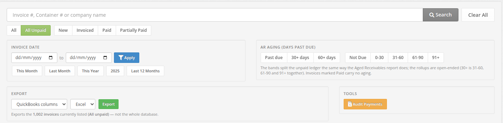

# Invoices

Find, filter, follow up on and export your freight invoices from one list.

## :fontawesome-solid-file-invoice-dollar: Overview

The **Invoices** page (subtitle *Management of Invoices*) is the working list for accounts receivable. From here you can see what each customer owes and how late it is, open the tools for emailing and payments, and export what you filtered for your accounting system.

- :fontawesome-solid-filter: **Status tabs**: **All**, **All Unpaid** (the default), **New**, **Invoiced**, **Paid**, **Partially Paid**
- :fontawesome-solid-magnifying-glass: **Search** by invoice ID, container number or company name
- :fontawesome-solid-calendar: **Invoice Date** range with quick presets
- :fontawesome-solid-clock: **AR Aging (Days Past Due)** rollups and exact bands, plus an aging badge on every unpaid row
- :fontawesome-solid-file-export: **Export** the invoices currently listed as QuickBooks columns or AR aging detail, in Excel or CSV
- :fontawesome-solid-scale-unbalanced: **Audit Payments** lists Paid invoices whose payment lines do not add up to the invoice total

This page covers the list. These topics have their own pages:

- Creating and editing an invoice: [Creating Invoices](creating-invoices.md)
- Emailing an invoice and recording payments: [Invoice Email & Payments](invoice-email-and-payments.md)
- Customer statements: [Customer Statements](customer-statements.md) and [Automatic Statements](automatic-statements.md)
- Totals per customer by age: [Aged Receivables](aged-receivables.md)

!!! info "Garage invoices are separate"
    If you use the Garage add-on, garage invoices are kept apart from freight invoices and never appear on this page. See [Garage Invoices](garage-invoices.md).

<!-- TODO: Screenshot — The Invoices list page showing invoice rows with aging badges, status labels and the totals footer -->

---

## :fontawesome-solid-bolt: Quick Start

1. Click **Invoices** in the left menu. The list opens on **All Unpaid**, newest invoices first.
2. Narrow it with a status tab, the search box, an **Invoice Date** range or an **AR Aging** option.
3. Click the :fontawesome-solid-envelope: envelope on a row to email that invoice, or open the :fontawesome-solid-gear: cog menu to **Print**, **Record a payment**, **Edit** or **Delete**.
4. To get the list into a file, pick a layout and a format in the **Export** panel and click **Export**.

To create an invoice, click **Add a new Invoice** at the top right. See [Creating Invoices](creating-invoices.md).

---

## :fontawesome-solid-shield-halved: Access & Permissions

| Role | Access |
|------|--------|
| :fontawesome-solid-user-shield: **Admin** | Full access: view, create, edit, email, record payments, delete, export, Audit Payments |
| :fontawesome-solid-user-tie: **Manager** | Full access to invoices of the offices they belong to |
| :fontawesome-solid-file-invoice-dollar: **Accountant** | Full access to invoices of the offices they belong to |
| :fontawesome-solid-headset: **Dispatch** | No access. The **Invoices** menu item is not shown |
| :fontawesome-solid-user: **Customer**, **Warehouse**, **Garage**, drivers | No access |

**How to get there:**

- :fontawesome-solid-arrow-right: From the left menu, click **Invoices**

!!! info "One office at a time"
    The list, the totals, the search and the export only cover the **office you are currently working in**. If your company runs several offices, switch office to see that office's invoices. See [Multi-Office](multi-office.md). (**Audit Payments** is the exception. See [Audit Payments](#audit-payments) below.)

---

## :fontawesome-solid-plus: Adding an Invoice

Click **Add a new Invoice** at the top right of the page. This opens the invoice form, where you pick the customer, terms, tax and the orders to bill.

!!! info "Invoices are created from this form only"
    There is no "create invoice" action on an order. To bill orders, start from **Invoices** > **Add a new Invoice**. The full walkthrough is in [Creating Invoices](creating-invoices.md).

---

## :fontawesome-solid-filter: Invoice Filters

The filter bar sits at the top of the Invoices page. Every control narrows the same list, and they combine. Pick a status, add a date range, add an aging option, and you get the invoices matching all three.

!!! tip "Your filters follow you into the export"
    The **Export** panel tells you exactly what you are about to download, for example *"Exports the 1,250 invoices currently listed (All unpaid) — not the whole database."* The file always matches the list on screen.

### :fontawesome-solid-magnifying-glass: Search

The search box (placeholder *Invoice #, Container # or company name*) matches any of these:

| You type | Matches |
|----------|---------|
| Digits only, e.g. `1234` | The invoice whose **ID** is that number. Leading zeros don't matter, so `01234` works too |
| The start of a container number, e.g. `MSCU12` | Invoices with an order whose container number **starts with** that text |
| Part of a company name, e.g. `logist` | Invoices for any customer whose name **contains** that text |

The three checks run together, so a digits-only search also returns invoices whose container number starts with those digits or whose company name contains them. Search is not case-sensitive. Type your text and click **Search** (or press Enter).

!!! tip "Search by the invoice digits"
    Invoice search matches the invoice's number. If your invoice numbers are shown with a prefix (for example `A26 - 01234`), type only the digits: `1234`.

Searching **narrows what you are already looking at**. It keeps your status tab, date range and aging option. On the default **All Unpaid** tab, a search will not find a paid invoice. Click **All** first if you are looking for an invoice that may be paid.

### :fontawesome-solid-tags: Filter chips and Clear All

Active filters show as small chips inside the search box. Click a chip (it ends in **✕**) to drop that one filter and keep the rest.

| Chip | Appears when | Removing it |
|------|--------------|-------------|
| Status tab name, e.g. **Paid ✕** | Any tab other than the default **All Unpaid** is selected | Goes back to **All Unpaid** |
| Date range, e.g. **Jan 1, 2026 – Mar 31, 2026 ✕**, **From Jan 1, 2026 ✕**, **Up to Mar 31, 2026 ✕** | An invoice date range is set | Clears both dates |
| Aging, e.g. **Past due ✕**, **30+ days ✕**, **Aged 31-60 ✕** | An AR aging option is selected | Clears the aging option |

The search text itself is not a chip. It stays in the box. **Clear All** (to the right of **Search**) resets the page to its default view: **All Unpaid**, no search, no dates, no aging.

### :fontawesome-solid-list-check: Status tabs

The status tabs filter on the invoice's **Status** value. The selected tab is highlighted in green.

| Tab | Shows |
|-----|-------|
| **All** | Every invoice, whatever its status |
| **All Unpaid** | Invoices with status **new**, **Invoiced** or **Partially Paid**. **This is the default tab** |
| **New** | Status **new**. A new invoice starts here and normally stays here until it is emailed |
| **Invoiced** | Status **Invoiced**. A successful email moves a **new** invoice here |
| **Paid** | Status **Paid** |
| **Partially Paid** | Status **Partially Paid** |

!!! info "Tabs follow the Status value, not the balance"
    A tab picks invoices by what is in the **Status** column. An invoice whose payments cover the total stays on **All Unpaid** until its status is changed to **Paid**.

### :fontawesome-solid-calendar: Invoice Date

Filter by the date on the invoice (both ends included). Pick a **from** and/or **to** date and click **Apply**, or click a preset:

**This Month** · **Last Month** · **This Year** · last year (shown as the year itself, e.g. *2025*) · **Last 12 Months**

You can set only one end: a *from* date alone shows everything from that day on, and a *to* date alone shows everything up to that day. The active preset is highlighted in green. Click **Clear dates** to drop the range and keep your other filters.

### :fontawesome-solid-clock: AR Aging (Days Past Due)

Aging answers "how late is this?" It is measured in days past the invoice's **due date**, as of today.

There are two ways to ask, side by side:

| Type | Options | Meaning |
|------|---------|---------|
| **Rollups** (open-ended) | **Past due** · **30+ days** · **60+ days** | "This old *and worse*." **30+ days** covers 31-60, 61-90 and 91+ together |
| **Bands** (exact) | **Not Due** · **0-30** · **31-60** · **61-90** · **91+** | Splits the unpaid ledger into exact buckets, the same way the [Aged Receivables](aged-receivables.md) report does |

Only one aging option can be active at a time. Click the active option again to turn it off.

!!! info "Details worth knowing"
    - **Past due** means at least one day late. An invoice falling due *today* sits in the **0-30** band without being past due.
    - Invoices with status **Paid** carry no aging, so no aging option returns them. Picking an aging option while on the **Paid** tab switches you to **All Unpaid**. Clicking **Paid** clears the aging option.
    - **New**, **Invoiced** and **Partially Paid** combine with aging. For example, **Invoiced** + **60+ days** lists invoices sent and more than 60 days late.
    - An old invoice with no due date on record is aged from its invoice date.

---

## :fontawesome-solid-table: Invoice List Columns

The list shows eight columns. Most pair a **main value** with a smaller related value underneath. Invoices are sorted **newest first** (by invoice ID) on every tab, **50 per page**.

| Column | Main value | Underneath |
|--------|-----------|------------|
| **Invoice** | Invoice number | Invoice date |
| **Company** | Customer name (a link, see below), or **Unknown** if none | Number of orders: **1 order**, **N orders**, or **—** |
| **Due date** | Due date, with the aging badge beside it | — |
| **Total** | Invoice total including taxes | — |
| **Balance** | Amount still owed. Shown in **bold red** when above zero, **$ 0.00** otherwise | **paid $ …**: total paid so far |
| **Last payment** | Date of a payment line (see below), or **—** | Number of payment lines, e.g. **2 checks** |
| **Status** | Status value, with a delivery label | **sent** *date* or **not sent** |
| **Actions** | Envelope button and cog menu | — |

### :fontawesome-solid-building: Company link

Click a company name to see **all unpaid invoices for that company**. The list switches to **All Unpaid** with the company name in the search box. Your date range and aging option are dropped. Add them back from the filter bar if you need them.

This is an ordinary search, so it also lists invoices of any other customer whose name contains the same text (for example, clicking *ABC Logistics* also shows *ABC Logistics East*).

### :fontawesome-solid-hourglass-half: Aging badge

Each unpaid invoice shows a small coloured badge next to its due date, naming its aging bucket:

| Badge | Colour | Meaning |
|-------|--------|---------|
| **Not Due** | Grey | Due date is still ahead |
| **0-30** | Blue | 0 to 30 days past due |
| **31-60** | Orange | 31 to 60 days past due |
| **61-90** | Red | 61 to 90 days past due |
| **91+** | Darker red | More than 90 days past due |
| **—** | Muted | The invoice is **Paid** and has no aging |

Hover over a badge to see the exact count, for example *"12 days past due"* or *"Due in 5 days"*.

### :fontawesome-solid-money-check: Last payment

**Last payment** shows a payment date from the invoice's payment lines. If the invoice has no payment lines, the invoice's own paid date is shown, or **—**. The count underneath (**1 check**, **3 checks**, **0 checks**) is the number of payment lines.

For a **Paid** invoice, **paid $ …** under the Balance shows the full invoice total.

### :fontawesome-solid-tag: Status

The **Status** column shows the value stored on the invoice, exactly as saved. A brand-new invoice reads **new** in lowercase. The others read **Invoiced**, **Paid** and **Partially Paid**.

**Changing the status inline:** click the status text to open a small editor titled *Enter new invoice status*. Pick **new**, **Invoiced**, **Paid** or **Partially Paid** and confirm. The change saves immediately.

Changing the status here does not add or remove payment lines. If you set an invoice to **Paid** and it has no payment lines and no paid date yet, today's date is recorded as its paid date.

Next to the status, a small label shows how the last email went:

| Label | Meaning |
|-------|---------|
| **OK** (green) | The last invoice email was handed off successfully |
| **Failed!** (red) | The last attempt failed. Hover over the label to see the error message |
| *(none)* | The invoice has never been emailed |

Underneath, **sent** *date* shows the date of the last successful email, or **not sent**.

### :fontawesome-solid-calculator: Totals footer

The **Total of invoices** row at the bottom adds up the **Total** and **Balance** columns **for the current page only** (up to 50 invoices), not for everything matching your filters. The line under the table says so, for example:

*"Totals above cover the 50 invoices on this page of 1,250 matching the current filters."*

For a total across all matching invoices, use the **Export** (the **AR aging detail** layout ends with a **TOTALS** row) or the [Aged Receivables](aged-receivables.md) report.

---

## :fontawesome-solid-gear: Row Actions

Each row has two controls in the **Actions** column.

### :fontawesome-solid-envelope: Envelope button: Email Invoice / Resend Invoice

There is no separate **Send** button. Click the envelope to open the email window for that invoice:

- **Blue envelope** (tooltip **Email Invoice**): the invoice has not been sent yet.
- **Grey envelope** (tooltip **Resend Invoice**): it was sent before.

A successful email of a **new** invoice changes its status to **Invoiced**. For recipients, attachments and the REVISED marking, see [Invoice Email & Payments](invoice-email-and-payments.md).

### :fontawesome-solid-gear: Cog menu

| Item | What it does |
|------|--------------|
| :fontawesome-solid-print: **Print** | Opens the printable invoice in a new browser tab |
| :fontawesome-solid-download: **EDI 210** | Downloads the invoice as an EDI 210 file named `EDI210_<invoice number>_<YYYYMMDD>.csv`. Only shown if your account has EDI invoicing turned on (ask UTX support) |
| :fontawesome-solid-money-bill: **Record a payment** | Opens the invoice in a pop-up window so you can add payment lines. See [Invoice Email & Payments](invoice-email-and-payments.md) |
| :fontawesome-solid-pen-to-square: **Edit** | Opens the full invoice form. See [Creating Invoices](creating-invoices.md) |
| :fontawesome-solid-xmark: **Delete** | Deletes the invoice after an *Are you sure?* confirmation |

!!! danger "Deleting an invoice"
    **Delete** removes the invoice itself and cannot be undone from this page. Its orders are not deleted: they are only detached from the invoice.

---

## :fontawesome-solid-file-export: Exporting Invoices

The **Export** panel is part of the filter bar. It exports **the invoices currently listed**, across all pages: whatever your status tab, search, invoice date range and aging option have narrowed the list to.

The line under the button always states what you are about to get, for example *"Exports the 1,250 invoices currently listed (All unpaid, past due) — not the whole database."*

**To export:**

1. Filter the list until it shows what you want.
2. In **Export**, pick a layout (**QuickBooks columns** or **AR aging detail**) and a format (**Excel** or **CSV**).
3. Click **Export**. The file downloads.

| Setting | Options | Description |
|---------|---------|-------------|
| Layout | **QuickBooks columns** | One row per invoice with amounts before and after tax, for importing into QuickBooks |
| | **AR aging detail** | One row per invoice with balance and aging detail, for collections and month-end |
| Format | **Excel** (.xlsx) | Default |
| | **CSV** (.csv) | Comma-separated values |

### QuickBooks columns layout

Rows are sorted by **invoice date** (oldest first), then invoice ID.

| Column | Contents |
|--------|----------|
| **Invoice** | Invoice number |
| **Invoice Date** | YYYY-MM-DD |
| **Customer** | Company name, or **Unknown** |
| **Details** | One entry per order, `<type> - <container>`, separated by commas. Types: **CI** import, **EX** export, **DV** dry van, **TF** transfer, **IX** international export |
| **Amount before sales taxes** | Subtotal of the orders |
| **GST Charged** | GST (0.00 if the invoice has no tax) |
| **QST Charged** | QST (0.00 if the invoice has no tax) |
| **Amount after sales taxes** | Invoice total |

### AR aging detail layout

Rows are sorted by **due date** (oldest first), then invoice ID. The last row is a **TOTALS** row adding up every money column.

| Column | Contents |
|--------|----------|
| **Invoice** | Invoice number |
| **Invoice Date** | YYYY-MM-DD |
| **Customer** | Company name |
| **Status** | Status value, as stored |
| **Terms** | Invoice terms |
| **Due Date** | YYYY-MM-DD |
| **Days Overdue** | Days past due as of today (negative = not due yet). Blank for Paid invoices |
| **Aging Bucket** | **Not Due**, **0-30**, **31-60**, **61-90**, **91+**, or **Settled** for Paid invoices |
| **Invoice Total** | Total including taxes |
| **Amount Paid** | Total minus balance |
| **Balance** | Amount still owed (0 for Paid invoices) |
| **Last Payment** | Same date as the **Last payment** column on screen |
| **Not Due** · **0-30** · **31-60** · **61-90** · **91+** | The balance, placed in the one column matching the invoice's bucket. The others show 0 |

!!! tip "Pivot-ready"
    Because each balance lands in exactly one bucket column, you can sum the bucket columns per customer to rebuild an aged receivables summary for exactly the invoices you filtered.

### File name

Files are named after your company, the layout, the status tab, the date range (when both dates are set) and today's date:

- QuickBooks columns, no date range: `<company>-invoices-<status>-on-DDMMYY.xlsx`
- AR aging detail, with a date range: `<company>-invoice-aging-<status>-<YYYYMMDD>-to-<YYYYMMDD>-on-DDMMYY.csv`

The status part is one of `all-invoices`, `all-unpaid`, `new`, `invoiced`, `paid`, `partially-paid`. The Excel worksheet is named after the status tab too (for example *All unpaid*).

!!! warning "Very large exports"
    An export builds the whole file at once, so it is capped at **20,000 invoices**. If your filters match more than that, you go back to the list with the message *"That export covers N invoices, which is more than the 20,000 this can build at once. Narrow it with the invoice date range, then export again."* Pick a range such as **This Year** or **Last 12 Months** and export in batches.

---

## :fontawesome-solid-scale-unbalanced: Audit Payments

**Audit Payments** (in the **Tools** panel, to the right of **Export**) is a **read-only report**. It opens a pop-up listing invoices that are marked **Paid** but whose payment lines do not add up to the invoice total.

**What it checks:**

- Invoices with status **Paid**, invoice date **January 1, 2024 or later**, that have **at least one payment line**
- The invoice total (orders + tax) is compared with the sum of its payment lines
- Any difference **greater than $0.02** is listed
- It looks at **all offices**, not just the one you are working in

| Column | Shows |
|--------|-------|
| **Invoice #** | Invoice number. Click it to open a search for that invoice in a new tab |
| **Date** | Invoice date |
| **Status** | Status (always Paid) |
| **Invoice Total** | What the invoice should total |
| **Total Paid** | Sum of its payment lines |
| **Difference** | Invoice Total minus Total Paid. Positive = under-paid, negative = over-paid |

If nothing is found, it reads *"No discrepancies found. All paid invoices match their payment lines."*

!!! info "Nothing is changed for you"
    Audit Payments does not fix anything and has no bulk update. To correct an invoice, open it (cog menu > **Record a payment** or **Edit**) and adjust its payment lines. See [Invoice Email & Payments](invoice-email-and-payments.md).

---

## :fontawesome-solid-circle-question: FAQ / Troubleshooting

### :fontawesome-solid-magnifying-glass: I searched for an invoice number and got nothing

!!! info "Solution"
    Check two things:

    1. **Search by the digits.** If your invoice numbers have a prefix like `A26 - 01234`, search for `1234`.
    2. **Check the status tab.** Search keeps the current tab, and the default is **All Unpaid**. Paid invoices only show on **All** or **Paid**.

    Also make sure you are in the right office: the list only shows the current office's invoices.

### :fontawesome-solid-calculator: The footer total doesn't match my aged receivables

!!! info "Solution"
    The footer only adds up the **current page** (50 invoices). For a full total, export with the **AR aging detail** layout (it ends with a **TOTALS** row) or use the [Aged Receivables](aged-receivables.md) report. The report and this list are not expected to match exactly: the report starts from your invoicing start date and counts payments as of its date, while the list includes every invoice and treats status **Paid** as settled.

### :fontawesome-solid-clock: A paid-up invoice still shows an aging badge

!!! info "Solution"
    Aging is based on **Status**, not on the balance. An invoice stays aged until its status is **Paid**. Click the status text and change it to **Paid**.

### :fontawesome-solid-circle-xmark: The status shows Failed!

!!! info "Solution"
    The last email attempt failed. Hover over **Failed!** to read the error, fix the cause (for example a wrong recipient address: the **To** field is pre-filled from the customer's accountant email), and click the envelope to send again. See [Invoice Email & Payments](invoice-email-and-payments.md).

### :fontawesome-solid-file-export: My export has more (or fewer) rows than I expected

!!! info "Solution"
    The export uses every active filter: status tab, search text, invoice date range and aging option. Read the caption under **Export**. It lists the count and filters before you click. Note that the export covers all pages, while the screen shows 50 at a time.

### :fontawesome-solid-building: An invoice from Audit Payments doesn't show when I click it

!!! info "Solution"
    Audit Payments covers all offices, but the list only shows your current office. Switch to the invoice's office and click the link again. See [Multi-Office](multi-office.md).

### :fontawesome-solid-headset: A dispatcher can't see the Invoices menu

!!! info "Solution"
    This is expected. Dispatch users have no access to invoices. Give the person the **Accountant** or **Manager** role if they need it. See [User Roles](user-roles.md).

---

## :fontawesome-solid-lightbulb: Best Practices

!!! tip "Tips"
    - Start collections from **AR Aging** > **60+ days**, then click a company name to see everything that customer owes.
    - Set a date range before exporting large histories. It keeps you under the 20,000-invoice cap and gives each file a clear period in its name.
    - Run **Audit Payments** before month-end close to catch Paid invoices with missing or mistyped payment lines.
    - Mark invoices **Paid** once fully paid so they leave **All Unpaid** and the aging filters.
