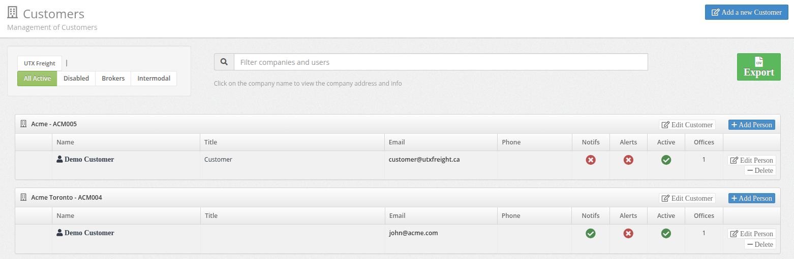
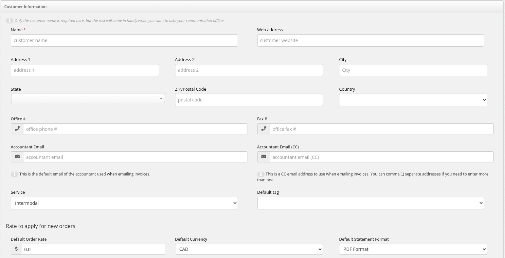
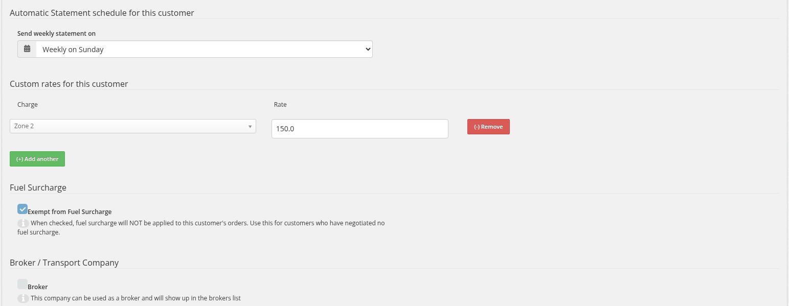
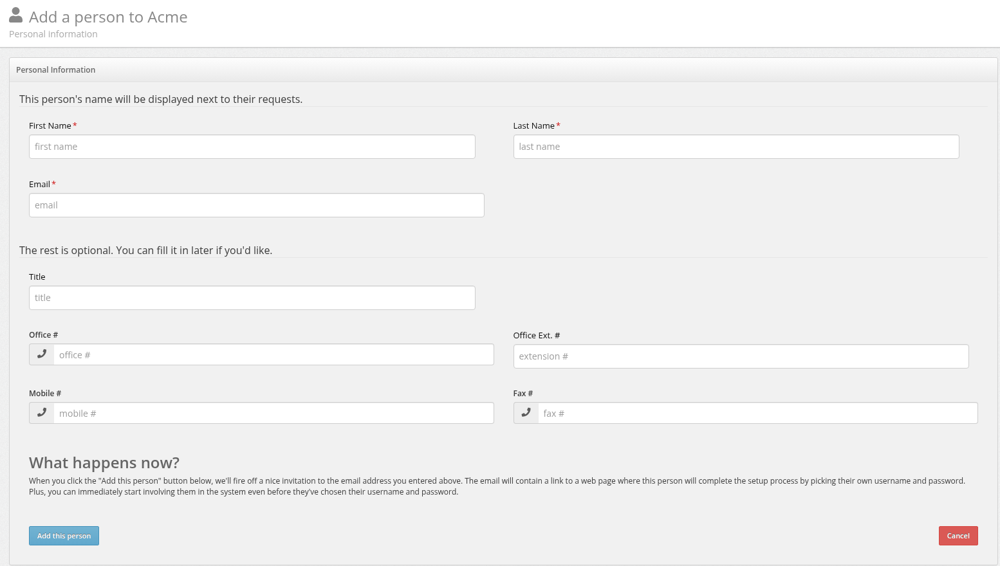

# Customers

Create and manage the customer companies (and their contact people) that you place orders, invoices and statements for in UTX Freight.

## :fontawesome-solid-building: Overview

Every order in UTX Freight is placed on behalf of a **person** who belongs to a **customer company**. Before you can create orders, you need at least one customer with one person.

- :fontawesome-solid-building: **Customers** (companies) are the billing entities. Each one has an address, accountant emails for invoices and statements, a service type, a currency and statement format, and optional custom rates.
- :fontawesome-solid-user: **People** belong to a customer. They are the contacts orders are placed for, they receive notifications, and they can log in. Each customer box on the list shows its people in a table. See [People & Invitations](people-and-invitations.md) for the details.
- :fontawesome-solid-house: **Your own company** is listed too, as **Your Company: <name>**. Your staff (admins, managers, dispatchers, accountants, drivers) are the people under it.
- :fontawesome-solid-dollar-sign: **Custom rates** override zone rates, terminal fees and warehouse charge prices for one customer.
- :fontawesome-solid-tag: **Default tag** pre-selects a tag on new orders for the customer.
- :fontawesome-solid-gas-pump: **Fuel surcharge exemption** turns off fuel surcharges for the customer (Fuel Surcharge add-on).
- :fontawesome-solid-envelope: **Automatic statements** can be scheduled per customer (when automatic statements are enabled on your account).

---

## :fontawesome-solid-bolt: Quick Start

1. Go to :fontawesome-solid-arrow-right: **Customers** from the left menu.
2. Click **Add a new Customer** (top right).
3. Enter the **Name** (the only required field).
4. Click **Save Changes**. You return to the Customers list, filtered to the new company.
5. In the new company's box, click :fontawesome-solid-plus: **Add Person**, fill in the person's details, and click **Add this person**.

!!! warning "The invitation is sent right away"
    When you click **Add this person**, UTX Freight immediately emails an invitation to the address you entered. Make sure the email address is correct before you save.

---

## :fontawesome-solid-shield-halved: Access & Permissions

| Role | Access Level |
|------|-------------|
| :fontawesome-solid-user-shield: **Admin** | Full access: create, edit, delete, add and edit people, and **Export** |
| :fontawesome-solid-user-tie: **Manager** | Full access: create, edit, delete, add and edit people. No **Export** button. In single-office accounts, a Manager can't edit your own company or its staff (see [Editing your own company](#editing-your-own-company)) |
| :fontawesome-solid-headset: **Dispatch** | Full access (create, edit, add and edit people) **only** when your account has Dispatch customer management turned on (ask UTX support). Dispatch cannot delete customers or people, and has no **Export**. Otherwise, Dispatch has no access and the **Customers** menu is hidden |
| :fontawesome-solid-file-invoice-dollar: **Accountant** | No access. The **Customers** menu is not shown |
| :fontawesome-solid-users: **Customer, Driver, Warehouse, Garage** | No access |

- Only **Admin** and **Manager** can delete a customer or a person.
- The **Export** button is shown to **Admin** users only.
- Garage users manage their own customer list in the Garage module. See [Garage Customers & Equipment](garage-customers-and-equipment.md).

**How to get there:**

- :fontawesome-solid-arrow-right: From the left menu, click **Customers**

!!! info "Multi-office accounts"
    In single-office accounts, users manage the customers of the offices they belong to. With [Multi-Office](multi-office.md), customers are shared: users can manage customers from any office, and the people of every office's customers appear in the order form. The Customers list itself shows the customers that belong to the office you are currently working in, and a new customer is created in your current office. The **Offices** column in the people table shows how many offices each person is assigned to.

---

## :fontawesome-solid-list: The Customers List

### :fontawesome-solid-filter: Filters

The filters sit in the box at the top left of the page:

| Filter | What It Shows |
|--------|-------------|
| **<Your company name>** (default) | Your own company only. This is the filter selected each time you open **Customers** |
| **All Active** | Customers that are active (not disabled) |
| **Disabled** | Customers whose **Active** box is unchecked |
| **Brokers** | Customers with the **Broker** box checked |
| **Warehouse** | Customers whose **Service** includes Warehouse (Warehouse add-on only) |
| **Intermodal** | Customers whose **Service** includes Intermodal (shown with the Warehouse add-on) |

After you create a customer, the list opens filtered to that company and its name appears as an extra filter link at the start of the box.

Deleted customers never appear under any filter.

### :fontawesome-solid-magnifying-glass: Search

Type in the **Filter companies and users** box to search. The search:

- starts once you have typed **2 or more characters** (clearing the box shows the full list again),
- matches, case-insensitive and on partial text, the **company name** and the **first name, last name and email** of the company's people,
- searches within the selected filter. With your own company selected (the default), the search covers all customers of the office you're working in that aren't deleted, both active and disabled. Your own company itself is not part of these search results.

The search does not match the Reference ID, address or phone numbers.

### :fontawesome-solid-table: What each customer box shows

The list shows **30 customers per page**, active customers first, then sorted alphabetically by name. Each customer has its own box:

- **Header**: your own company shows as **Your Company: <name>**; other customers show as **<name> - <Reference ID>**. A disabled customer's name is shown in red. Brokers have a blue **Broker** label.
- **Click the company name** to open an info window with the customer's **Address** (Address 1, then city, state and postal code), **Phone Number** and **Fax Number** (each only when filled in) and **Comments**. Click **Close** to dismiss it. The hint under the search box says *Click on the company name to view the company address and info*.
- **Buttons** (for users who can manage the customer): **Edit Customer** (always visible), **Add Person**, and **Delete** (only when deletion is allowed, see [Deleting a Customer](#deleting-a-customer)).
- **People table** with the columns **Name**, **Title**, **Email**, **Phone**, **Notifs**, **Alerts** (only with a container tracking add-on), **Active**, **Offices**, and the **Edit Person** and **Delete** buttons. The first column shows a badge for staff (**Owner**, or the role name such as Admin, Manager or Dispatch) and an **Invited** badge for people who haven't accepted their invitation yet.

#### Reference ID

The Reference ID is built automatically from the first three letters of the company name (spaces and hyphens removed, in capitals) followed by the company's internal number, padded to at least three digits. For example, a company named "Acme Logistics" with number 7 shows as `ACM007`. Because it comes from the name, the Reference ID changes if you rename the company. You can't edit it directly.

---

## :fontawesome-solid-plus: Creating a Customer

1. Navigate to :fontawesome-solid-arrow-right: **Customers**.
2. Click **Add a new Customer** (top right).
3. Fill in the **Customer Information** form. Only **Name** is required.
4. Click **Save Changes** (or **Cancel** to go back to the list).

On success you see **Customer was successfully created.** If **Name** is empty, the form reloads and shows **can't be blank** under the field.

The form is a single page with these sections, from top to bottom: **Customer Information**, **Rate to apply for new orders**, **Automatic Statement schedule for this customer** (only when enabled), **Custom rates for this customer**, **Fuel Surcharge** (Fuel Surcharge add-on only), **Broker / Transport Company**, **Additional comments** and **Customer visibility**. The tables below follow that order.

### Customer Information: address and phone

| Field | Description |
|-------|-------------|
| **Name** | Company name (required). Leading and trailing spaces are removed when you save |
| **Web address** | Company website |
| **Address 1 / Address 2** | Street address |
| **City** | City name |
| **State** | Province or state, picked from the dropdown |
| **ZIP/Postal Code** | Postal or ZIP code |
| **Country** | **Canada (CA)** or **United States (US)** |
| **Office #** | Office phone number |
| **Fax #** | Fax number |

### Customer Information: accountant emails

| Field | Description |
|-------|-------------|
| **Accountant Email** | The default email of the customer's accountant, used when emailing invoices. It's also the "To" address for statements |
| **Accountant Email (CC)** | A CC address used when emailing invoices. Separate several addresses with commas |

### Customer Information: service, tag and default user

| Field | Description |
|-------|-------------|
| **Service** | What this customer uses you for. Options: **Intermodal**; **Warehouse** and **Intermodal & Warehouse** (Warehouse add-on); **Garage** (Garage add-on). Only people of customers whose service includes **Intermodal** appear in the order form's **Place the order on behalf of** list. Customers with **Warehouse** are the ones available for warehouse orders |
| **Default tag** | Shown only when your account has order tags configured. See [Default Tag](#default-tag) |
| **Default user** | Shown only when editing an existing customer whose **Service** is exactly **Intermodal** (not **Intermodal & Warehouse**). Pick one of the customer's people who is active for orders. Used by automated document-to-order imports to decide which person the imported order is placed for |

### Rate to apply for new orders

| Field | Description |
|-------|-------------|
| **Default Order Rate** | Read-only (greyed out). You can't change it on this form. It is copied into a new order's base rate when the order for this customer doesn't already have one |
| **Default Currency** | **CAD** or **USD** |
| **Default Statement Format** | **PDF Format** or **Excel (.xlsx)**. The file format used when a statement is emailed to this customer. See [Customer Statements](customer-statements.md) |

### Additional comments and Customer visibility

| Field | Description |
|-------|-------------|
| **Comments** (section **Additional comments**) | Free-text notes. They appear in the info window when you click the company name on the list |
| **Active** (section **Customer visibility**) | Hint: *Order can only be placed for active customers*. Uncheck to disable the customer (see [Disabling a Customer](#disabling-a-customer)) |

---

## :fontawesome-solid-pencil: Editing a Customer

1. On the **Customers** list, find the company (use a filter or search).
2. Click **Edit Customer** in the company's box.
3. Update the fields as needed.
4. Click **Save Changes**.

On success you return to the list with **Customer was successfully updated.**

The sections below are on the same form used for creating a customer.

### :fontawesome-solid-tag: Default Tag { #default-tag }

The **Default tag** field appears when your account has at least one order tag configured (it's not a separate add-on). Pick the tag that should be used for this customer's orders.

When an Admin, Manager or Dispatch user creates a new order and chooses one of this customer's people in **Place the order on behalf of**, the tag is pre-selected. You can still change it on the order. See [Order Tagging](order-tagging.md).

### :fontawesome-solid-calendar-days: Automatic Statement Schedule

The **Automatic Statement schedule for this customer** section only appears when automatic statements are turned on for your account (ask UTX support). Choose a value in **Send weekly statement on**:

| Option | When the statement is sent |
|--------|-------------|
| **Weekly on Sunday** … **Weekly on Saturday** | Every week on that day |
| **Bi-Weekly on the 2nd and 16th** | On the 2nd and the 16th of each month |
| **Monthly on the 1st** | On the 1st of each month |
| **Monthly on the 15th** | On the 15th of each month |
| **Not Scheduled** | Never sent automatically |

The statement is emailed to the **Accountant Email** (with the **Accountant Email (CC)** addresses in CC), in the **Default Statement Format**, only if the customer is **Active** and has unpaid invoices. If there's nothing owing, no email goes out. In single-office accounts the delivery is then recorded as **Statement Not Sent (0.0$)**. Without an **Accountant Email**, no automatic statement can be sent.

!!! tip "Choose a schedule for each new customer"
    On a new customer, or on any customer that has no schedule yet, **Send weekly statement on** starts at **Weekly on Sunday**, the first choice in the list. Choose **Not Scheduled** if the customer shouldn't receive automatic statements.

You can also change the schedule from the customer statements screen. For full details, see [Automatic Statements](automatic-statements.md).

### :fontawesome-solid-dollar-sign: Custom Rates { #custom-rates }

The **Custom rates for this customer** section lets you set prices that apply only to this customer. Each row has:

- **Charge**: a dropdown grouped into **Zone**, **Terminal** and **Warehouse** (warehouse charges). Only active items are listed.
- **Rate**: the amount to use for this customer.

Click **(+) Add another** to add a row and **(-) Remove** to delete one, then click **Save Changes**.

| Charge group | What the custom rate overrides |
|--------------|-------------------------------|
| **Zone** | The zone's rate. When an order's location falls in that zone, this customer's rate is suggested instead of the zone's standard rate. See [Zones & Cities](zones-and-cities.md) |
| **Terminal** | The terminal's **Default Rate** for the automatic **Terminal Fee** charge (the pickup terminal on imports, the return terminal on exports). The fee is only added while the order is not completed or invoiced, and only when the resulting rate is above zero. See [Managing Terminals](managing-terminals.md) |
| **Warehouse** | The rate shown next to that warehouse charge in the charge drop-down on this customer's warehouse orders. See [Warehouse Orders](warehouse-orders.md) |

### :fontawesome-solid-gas-pump: Fuel Surcharge Exemption

When the **Fuel Surcharge** add-on is enabled, the form has a **Fuel Surcharge** section:

- Check **Exempt from Fuel Surcharge**. The hint reads: *When checked, fuel surcharge will NOT be applied to this customer's orders. Use this for customers who have negotiated no fuel surcharge.*

If you turn the exemption on and the customer has uninvoiced orders that are not **Completed** and already carry a fuel surcharge, a warning appears after saving:

> *<Customer name> has N open order(s) with fuel surcharges that need recalculation. Visit the Fuel Schedule to recalculate.*

Go to **Fuel Schedule** and click **Recalculate** on the affected months to remove those charges. For full details, see [Fuel Surcharge — Exempting a Customer](fuel-surcharge.md#exempting-a-customer).

### :fontawesome-solid-handshake: Broker / Transport Company

Check **Broker** to flag the company as a broker. Hint: *This company can be used as a broker and will show up in the brokers list*. Broker companies get a **Broker** label on the Customers list and appear under the **Brokers** filter.

### :fontawesome-solid-house: Editing your own company { #editing-your-own-company }

Your own company (**Your Company: <name>**) uses the same form. It isn't tied to an office and it can never be deleted.

Because it isn't tied to an office, in single-office accounts only **Admin** users see **Edit Customer** and **Add Person** on your own company, and the **Edit Person** and **Delete** buttons on your staff. Managers (and Dispatch users with customer access) see the box and its people but no buttons. With [Multi-Office](multi-office.md), Managers and Dispatch users with customer access can manage it too.

---

## :fontawesome-solid-user-plus: Adding People

1. On the **Customers** list, find the company.
2. Click :fontawesome-solid-plus: **Add Person**.
3. Fill in **First Name**, **Last Name**, **Email** and the other contact details.
4. Click **Add this person**.

The invitation email goes out immediately. It contains a link where the person picks their own password and finishes setting up their account. You can start using the person on orders before they accept.

To change a person, click **Edit Person** on their row. If they haven't accepted their invitation yet, the Edit Person page shows when the last invitation was sent, a **resend the email** button, and the invitation link you can copy and send yourself. There's no resend button on the Customers list.

For roles, notifications, alerts, **Active for orders** and offices, see [People & Invitations](people-and-invitations.md).

---

## :fontawesome-solid-ban: Disabling a Customer { #disabling-a-customer }

Disabled customers stay in the system with all their orders and invoices, but no new orders can be placed for them. To disable:

1. Click **Edit Customer**.
2. Uncheck **Active** in the **Customer visibility** section.
3. Click **Save Changes**.

The company name turns red on the list and the customer moves to the **Disabled** filter. Disabled customers also stop receiving automatic statements. To re-enable, check **Active** again.

---

## :fontawesome-solid-trash: Deleting a Customer { #deleting-a-customer }

The **Delete** button only appears in a customer's box when **all** of these are true:

- it's not your own company,
- the customer has no invoices,
- the customer has no people, including people who were deleted earlier.

Click **Delete**, then confirm **Are you sure you want to delete this company?** You see **Customer was successfully deleted.**

Only **Admin** and **Manager** can delete. A deleted customer is marked inactive and disappears from every filter and search, but its record is kept (it still appears in the export). There's no way to restore it from the Customers page.

!!! tip "Can't delete? Disable instead"
    A customer with invoices or people can't be deleted. Uncheck **Active** to hide it from new orders instead.

---

## :fontawesome-solid-file-export: Exporting Customers

**Admin** users see a green **Export** button on the right of the Customers page, next to the search box. It downloads a **CSV** file named `<your company>-companies-<date>.csv`.

| Column | Content |
|--------|---------|
| **Id** | Internal company number |
| **Name** | Company name |
| **Address one** | Address 1 |
| **City** | City |
| **State** | State/province |
| **Zip** | ZIP/postal code |
| **Country** | Country |
| **Active** | `true` or `false` |

The export lists companies only: no people or contact details, and no emails or phone numbers. It includes **every** company: your own company, active, disabled and deleted customers. It ignores the filter and search on the page. See also [Data Exports](data-exports.md).

---

## :fontawesome-solid-clock-rotate-left: Change History

Changes to customer records are recorded in the system's change history. The Customers page has no **Audit** button to view it.

---

## :fontawesome-solid-circle-question: FAQ / Troubleshooting

### :fontawesome-solid-ban: Customer or person doesn't appear in the order form dropdown

!!! info "Solution"
    The **Place the order on behalf of** list only shows people when all of these are true:

    - the customer is **Active** (check the **Disabled** filter) and not deleted,
    - the customer's **Service** includes **Intermodal** (a customer set to only **Warehouse** or **Garage** won't appear),
    - the person is not deleted and **Active for orders** is checked on their **Edit Person** page,
    - the customer has at least one person,
    - in single-office accounts, the person is assigned to the office you're currently working in (with [Multi-Office](multi-office.md), people from every office are listed).

### :fontawesome-solid-envelope: A person didn't receive the invitation email

!!! info "Solution"
    Click **Edit Person** on their row. The page shows when the last invitation was sent. Click **resend the email**, or copy the invitation link shown there and send it to them yourself. Check that the email address is correct.

### :fontawesome-solid-trash: There's no Delete button on a customer

!!! info "Solution"
    The **Delete** button is hidden for your own company, for customers with invoices, and for customers that have (or had) people. Disable the customer instead. Also, only Admin and Manager can delete.

### :fontawesome-solid-eye-slash: I can't see the Customers menu

!!! info "Solution"
    Accountants have no access to Customers. Dispatch users only see it when Dispatch customer management is turned on for your account. Ask UTX support.

### :fontawesome-solid-magnifying-glass: My search returns nothing

!!! info "Solution"
    Type at least 2 characters. The search looks within the selected filter: if **Brokers** or **Disabled** is selected, only those customers are searched. Switch to **All Active** or to your own company filter to search more widely. Deleted customers are never found.

### :fontawesome-solid-house: I can't edit my own company

!!! info "Solution"
    In single-office accounts, only Admin users can edit your own company and its staff. Ask an Admin. See [Editing your own company](#editing-your-own-company).

### :fontawesome-solid-dollar-sign: I can't change the Default Order Rate

!!! info "Solution"
    **Default Order Rate** is read-only on the customer form. To give a customer different prices, use **Custom rates for this customer** (zones, terminals, warehouse charges).

---

## :fontawesome-solid-lightbulb: Best Practices

!!! tip "Tips for managing customers"
    - Fill in the **Accountant Email** right away. Invoices and statements use it.
    - Set the **Service** correctly. It decides whether the customer shows up for intermodal orders, warehouse orders, or both.
    - Use **Custom rates for this customer** for negotiated prices instead of editing each order by hand.
    - Disable customers you no longer work with rather than leaving them active. They stay in your history but drop out of the order form.
    - Double-check email addresses before clicking **Add this person**. The invitation goes out immediately.
