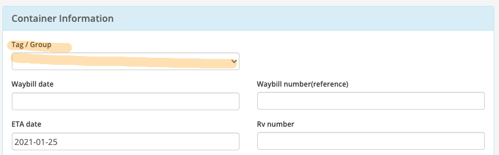
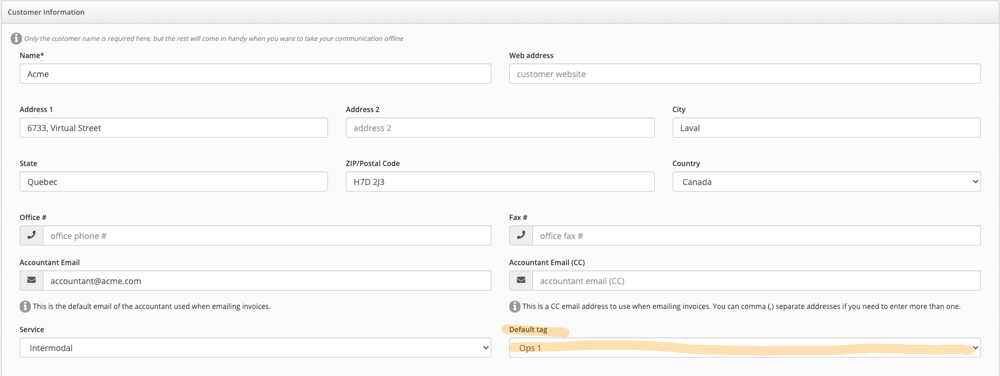
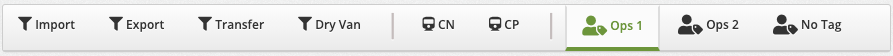

# Order Tags

Add a **Tag / Group** label to orders so your team can sort, filter and visually spot related work on the **Orders** and **Dispatch** pages.

## :fontawesome-solid-tags: Overview

- A tag is a **label only**. It does not assign the order to a dispatcher, driver or office, and it does not change rates, statuses or notifications.
- Each order can carry **one** tag at a time.
- The list of tags is **set up by UTX for your account**. Users cannot create, rename or delete tags in the app.
- If no tags are configured for your account, the feature is completely hidden: no **Tag / Group** field, no **Default tag** field and no tag filters.
- Your account is configured with tags either **optional** (the **Tag / Group** dropdown has a blank entry) or **required** (the dropdown has no blank entry). "Required" only affects the dropdown: orders created without a form (duplicated orders, automatic orders) can still have no tag.
- A customer can have a **Default tag**, recording the group that customer usually belongs to.
- Tagged orders show a coloured order number in the order lists, and you can filter the **Orders** and **Dispatch** pages by tag.

## :fontawesome-solid-bolt: Quick Start

1. Ask UTX to configure your tag names (and whether a tag is required) for your account.
2. Optionally set a **Default tag** on each customer: :fontawesome-solid-building: **Customers** > **Edit Customer**.
3. Set or change the tag on an order with **Tag / Group** in **Quick Edit**, **Edit Order**, the New Order form or the **Complete Order** window.
4. Filter by tag using the tag buttons on the **Dispatch** page (or on the **Orders** page for intermodal accounts).
5. Check the **Tag / Group** value on every new order before you click **Submit Order**.

## :fontawesome-solid-lock: Access & Permissions

| Role | What they can do with tags |
|------|---------------------------|
| :fontawesome-solid-user-shield: **Admin** | Set the tag on orders, set a customer's **Default tag**, filter by tag on **Dispatch** and **Orders** |
| :fontawesome-solid-user-tie: **Manager** | Set the tag on orders, set a customer's **Default tag**, filter by tag on **Dispatch** and **Orders** |
| :fontawesome-solid-headset: **Dispatch** | Set the tag on orders, filter by tag on **Dispatch** and **Orders**. Can edit customers (and their **Default tag**) only if your account allows dispatchers to manage customers |
| :fontawesome-solid-calculator: **Accountant** | Can set the tag on **Dispatched** orders (**Quick Edit**, **Edit Order**, **Complete Order**). Can set it on orders in any status when your account allows accountants to manage orders. Can use the tag buttons on the **Orders** page (intermodal accounts). No access to the **Dispatch** page or to customers |
| :fontawesome-solid-user: **Customer** | When your account lets customers create and edit their own orders, the **Tag / Group** field also appears on their order form, so they can see and set it on orders that are still **New**. Customers cannot edit customers or their **Default tag**. On intermodal accounts they also see the tag buttons on the **Orders** page |

!!! info "Who configures the tags?"
    Tag names, their order and whether a tag is required are account settings managed by UTX. Contact UTX support to add, rename or remove a tag, or to switch between optional and required tags.

## :fontawesome-solid-pen-to-square: Setting the Tag on an Order

The **Tag / Group** dropdown appears in several places. It lists the tags configured for your account.

| Where | How to get there | Section |
|-------|------------------|---------|
| **New Order** form | **Orders** page > **Create a new order** | **Order Information** |
| **Edit Order** form | Order action button caret :fontawesome-solid-caret-down: > **Edit Order** | **Order Information** |
| **Quick Edit** window | Order action button caret :fontawesome-solid-caret-down: > **Quick Edit** | **Container Information** |
| **Complete Order** window | Click the **Complete** action button on a dispatched order | **Container Information** |

### Changing a tag with Quick Edit

The order action control on the **Orders** and **Dispatch** pages is a split button: the left part runs the next step (for example **Make App.**, **Dispatch** or **Complete**), and the caret :fontawesome-solid-caret-down: on the right opens a menu.

1. On the **Orders** or **Dispatch** page, click the caret :fontawesome-solid-caret-down: next to the order's action button.
2. Select **Quick Edit**.
3. Under **Container Information**, pick a new value in **Tag / Group**.
4. Click **Update Order**.

### Removing a tag

- **Optional tags:** choose the blank entry at the top of the **Tag / Group** dropdown and save.
- **Required tags:** the dropdown has no blank entry, so a tag can only be **changed**, never removed.

!!! warning "Required tags pre-select the first tag"
    When your account requires a tag, the **Tag / Group** dropdown has no empty option, so the first tag in the list is shown as selected whenever the order has no tag yet. This happens on a new order and also when you open **Quick Edit**, **Edit Order** or **Complete Order** on an order that has no tag (for example a duplicated order). Saving the form then gives the order that first tag. Check the value before you click **Submit Order** or **Update Order**.

## :fontawesome-solid-building: Customer Default Tag

A customer's **Default tag** records the group that customer's orders usually belong to.

1. From the left menu, select :fontawesome-solid-building: **Customers**.
2. Find the customer by name.
3. Click **Edit Customer**.
4. Select a tag in the **Default tag** dropdown (leave it blank for no default).
5. Click **Save Changes**.

The **Customers** menu, the **Edit Customer** button and the **Default tag** field are available to Admin and Manager users, and to Dispatch users when your account lets dispatchers manage customers. The **Default tag** field only appears when tags are configured for your account.

!!! tip "Check the tag on each order"
    The tag is set per order. Always check the **Tag / Group** value on the order form before you click **Submit Order** or **Update Order**. Changing a customer's **Default tag** does not update orders that already exist.

## :fontawesome-solid-filter: Filtering by Tag

### Dispatch page

The **Dispatch** page is available to Admin, Manager and Dispatch users. When tags are configured, its filter bar shows a :fontawesome-solid-user-tag: button for each tag, followed by a **No Tag** button.

- Click a tag to show only orders with that tag. Click it again to turn the filter off.
- Click **No Tag** to show only orders without a tag.
- Only one tag filter is active at a time. It combines with the other Dispatch filters (search box, terminal, order type, and so on).
- Selecting a container status filter clears the other filters, including the tag filter.

### Orders page

The **Orders** page shows tag buttons **only for intermodal accounts**, for every role that can open the page. They appear next to the status tabs (**All**, **In Progress**, **New**, **App. Made**, **Dispatched**, **Completed**, ...).

- Click a tag button to show only orders with that tag. The active button turns green and a **Tag: &lt;name&gt;** chip appears in the search bar. The tag filter combines with the status tab, the search box and the other filters on the page.
- Click the active button again, or click the **Tag: &lt;name&gt; ✕** chip, to remove the filter.
- **Clear All** removes every filter on the page, including the tag.
- There is no **No Tag** button on the **Orders** page. To find untagged orders, use the **Dispatch** page.

<!-- TODO: Screenshot — Orders page tag buttons next to the status tabs, with an active tag chip in the search bar -->

!!! info "Button names are capitalized"
    Tag buttons on both pages show the tag name with only the first letter in capitals. A tag configured as `AGH` appears as **Agh**. The full name appears as configured in the **Tag / Group** dropdown and in the **Tag:** filter chip.

## :fontawesome-solid-palette: Color Guide

Tagged orders show their order number on a badge in the **Orders** and **Dispatch** lists. The colour depends on the tag's position in your account's tag list. The tag name itself is not displayed on the row.

| Tag | Order number display |
|-----|---------------------|
| First tag | :fontawesome-solid-square:{ style="color: #519839" } Green badge |
| Second tag | :fontawesome-solid-square:{ style="color: #d9b51c" } Amber badge |
| Any other tag | Badge with no background colour |
| No tag | Plain order number, no badge |

<!-- TODO: Screenshot — Orders list rows showing green and amber order number badges -->

To see which tag an order has, open **Quick Edit** or **Edit Order**, or use the tag filters.

## :fontawesome-solid-clock-rotate-left: Where Tags Appear (and Don't)

| Place | Tag shown? |
|-------|-----------|
| **Tag / Group** field on order forms | Yes |
| Order number colour in **Orders** and **Dispatch** lists | Yes (first and second tags only) |
| **Order History** (order action menu > **View History**, for users who have access to it) | Yes, changes are recorded with the tag name |
| Emails to customers | No |
| Invoices | No |
| PODs | No |
| Duplicated orders | No, the tag is not copied |

## :fontawesome-solid-circle-question: FAQ / Troubleshooting

### :fontawesome-solid-eye-slash: I don't see the Tag / Group field anywhere

!!! info "Solution"
    Tags are hidden when no tags are configured for your account. Contact UTX support to have tags set up. Customer users only see the field when your account lets customers create and edit their own orders.

### :fontawesome-solid-plus: How do I create a new tag?

!!! info "Solution"
    You can't create tags in the app. UTX configures the tag list for your account. Contact UTX support with the tag names you need.

### :fontawesome-solid-user-tag: Does tagging an order assign it to a dispatcher?

!!! info "Solution"
    No. A tag is only a label used for filtering and colouring. It does not assign the order to anyone or notify anyone. If your team uses tags to split work between people or groups, that is a team convention, not something the app enforces.

### :fontawesome-solid-ban: I can't remove the tag from an order

!!! info "Solution"
    Your account requires a tag on every order, so the **Tag / Group** dropdown has no blank option. You can change the tag but not clear it. Contact UTX support if tags should be optional.

### :fontawesome-solid-filter: I can't find the tag buttons on the Orders page

!!! info "Solution"
    Tag buttons on the **Orders** page are only shown for intermodal accounts. The **Dispatch** page (Admin, Manager and Dispatch users) always shows tag filters when tags are configured.

### :fontawesome-solid-palette: My order number has no colour even though it is tagged

!!! info "Solution"
    Only the first and second tags have a colour (green and amber). Orders with any other tag show a badge without a background colour. Open **Quick Edit** to see the tag.

### :fontawesome-solid-copy: I duplicated an order and the copies have no tag

!!! info "Solution"
    Duplication does not copy the tag. Set it on each copy with **Quick Edit**. If your tags are required, opening **Quick Edit** on the copy shows the first tag pre-selected, so pick the right one before you click **Update Order**. See [Order Duplication](order-duplication.md).

## :fontawesome-solid-lightbulb: Best Practices

!!! tip "Getting the most out of tags"
    - When asking UTX to configure tags, ask for your two most-used groups to be first and second in the list, so they get the green and amber colours.
    - Set a **Default tag** on customers that always belong to the same group, and check the **Tag / Group** value on each order before you submit.
    - After duplicating orders, or when customers or automatic orders create orders, filter by **No Tag** on the **Dispatch** page to catch untagged orders.
    - Use **View History** (if you have access to it) to see who changed an order's tag and when.

## Related Pages

- [Orders](orders.md)
- [Order Form](order-form.md)
- [Dispatch](dispatch.md)
- [Managing Customers](managing-customers.md)
- [Order Duplication](order-duplication.md)
- [User Roles](user-roles.md)
